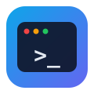

<p align="center">
  
</p>

<h1 align="center">The Harness</h1>

<p align="center">
  <strong>A small, complete agentic coding CLI</strong> — Claude Code shape, Python body.<br>
  ~1800 lines, stdlib-first, one OpenAI-compatible model endpoint. Built phase by phase with Hermes-agent as the reference design.
</p>

<p align="center">
  
  
  
</p>

```text
you > refactor the login flow to use sessions instead of cookies
assistant
  thinking...  (dim/italic reasoning block, then ───)
  ├─ read_file({"path":"src/auth.py"})
  └─ ...file contents...
  ├─ delegate({"tasks":[
       {"goal":"map the auth-related files","context":"..."},
       {"goal":"find all cookie usages","context":"..."}]})
  └─ [2 subagent(s) finished]
  ...synthesized answer...
  model │ ctx 12345/38000 (32%) │ in:9000 out:400
```


## Features

- **Agent loop** with tool calling, 20-turn cap, automatic error recovery
  (errors go back to the model as strings, never crashes)
- **Coding tools**: `list_files`, `read_file`, `write_file`, `edit_file`,
  `search_files`, `run_command` — path-jail, output caps, secret-file refusal
- **Safety gate** — tiered approvals (reads free, writes/exec ask), persistent
  allow rules, hardline blocklist, secret/redirect/env guards, and
  `ask` / `auto` / `plan` modes
- **Two-tier context management** — prune old tool output at 45%, LLM-summarize
  the middle at 75%, archive (never delete) so nothing is truly lost
- **Persistent sessions** — SQLite notebook, write-through, crash-resume,
  `/resume`, `/search` across all sessions incl. subagent transcripts
- **Streaming OpenCode-style UI** — line-buffered markdown, boxed code fences,
  tool tree (`├─`/`└─`), status line, hidden "thinking..." indicator
- **Thinking tokens** — `delta.reasoning` routed to a dim/italic block, never
  stored in history
- **Parallel subagents** via `delegate` — children run in threads with their own
  context windows and their own sessions; `MAX_SUBAGENTS=3` per batch; multiple
  batches in one turn run side by side
- **Parallel tool execution** — every tool call in one assistant turn runs
  concurrently, results returned in call order
- **Cross-session memory** — `session_search` tool lets the model (and you)
  grep everything ever stored

## Quick start

On a **fresh machine** (one command does everything — venv, deps, PATH, `.env`):

```bash
git clone <repo> the-harness && cd the-harness
./install.sh
```

`install.sh` creates `.venv`, installs `openai` + `python-dotenv` + `textual`,
links `harness` into `~/.local/bin` (already on your PATH), and copies
`.env.example` → `.env`. Edit `.env` (API key, `BASE_URL`, `MODEL`).

By hand, if you prefer:

```bash
git clone <repo> the-harness && cd the-harness
python3 -m venv .venv
.venv/bin/pip install -r requirements.txt   # openai, python-dotenv, textual
cp .env.example .env                        # then edit it
ln -s "$(pwd)/harness" ~/.local/bin/harness # ~/.local/bin is already on PATH
```

Then, in **any** project folder:

```bash
cd ~/projects/my-app
harness                     # starts the agent on the folder you are in
harness ~/projects/other    # ...or on another folder
harness -m gpt-4o-mini      # ...with another model
```

`harness` is a thin launcher: it runs the CLI with the venv python, keeps your
current folder as the project, and keeps every file of its own out of it.

`.env` (in the harness folder):

```
OPENAI_API_KEY=ollama                  # server ignores it; SDK requires one
BASE_URL=https://<tunnel>.trycloudflare.com/v1   # any OpenAI-compatible endpoint
MODEL=k2-horizon-mova-36b-a4b
```

All settings live in `config.py` and are overridable in `.env` (`CONTEXT_LIMIT`,
`MAX_SUBAGENTS`, `MAX_SPAWN_DEPTH`, …).

> `python`/`python3` are not on PATH in this environment — always use
> `.venv/bin/python` (the `harness` script does that for you).

## Terminal UI (Textual)

The same agent, with an opencode-style terminal front-end: dark, chat-centred,
keyboard-first.

```bash
cd ~/projects/my-app
.venv/bin/python -m tui            # the folder you are in is the project
.venv/bin/python -m tui ~/other    # ...or another folder
.venv/bin/python -m tui -m gpt-4o  # ...with another model
```

After `./install.sh` there is also a `harness-tui` command, same idea as
`harness`:

```bash
cd ~/projects/my-app
harness-tui
```

| Key | What it does |
|---|---|
| `enter` | send |
| `shift+enter` | new line in the prompt |
| `esc` | interrupt the running generation |
| `ctrl+p` | command palette — switch session or model |
| `ctrl+c` | quit |

Slash commands: `/new [title]`, `/sessions`, `/model [name]`, `/clear`, `/help`.

What you get:

- **streaming** — the answer appears live in a markdown block; the UI never blocks
- **tool calls** — one compact block per call: name, arguments, status dot
  (running / done / failed / denied) and the output; click to expand
- **diffs** — file edits are snapshotted before and after the call and shown as a
  coloured diff (green added, red removed)
- **approvals** — shell commands and file writes ask first: `y` once,
  `a` always allow, `n` deny (same policy as the CLI)
- **sessions** — `/sessions` and the palette list the stored sessions; picking one
  replays its transcript

The harness core is untouched: the UI drives it through `tui/adapter.py`, which
runs the agent loop in a worker thread and turns its activity into small events.
The one change to the core is an optional `stop` hook on `llm.chat()` so a
generation can be interrupted.

Every colour lives in `tui/app.tcss` as a variable — edit those ten lines to
re-theme the whole app.

## Your project stays clean

The harness keeps **its own files outside the project it works on** — the same
way opencode keeps its data in `~/.local/share/opencode`:

| What | Where | Override |
|---|---|---|
| session notebook (`state.db`), safety rules (`safety.json`), `/export` JSONL | `~/.harness/` | `HARNESS_HOME` env (or `.env`) |
| the project the agent reads/writes | the folder you run `harness` in, `--project <dir>`, `PROJECT_DIR` env | — |

So `harness` never drops a `.harness/`, a `__pycache__/`, or a database into
your project — the only files that appear there are the ones the agent was
asked to create or edit. A v1 `<harness>/.harness` folder is migrated into
`HARNESS_HOME` automatically on the first run.

## REPL commands

| Command | What it does |
|---|---|
| `/new [title]` | start a fresh session |
| `/sessions` | list sessions (id, title, message count, end reason) |
| `/resume <id\|title>` | load a session, show recap, warn if interrupted mid-turn |
| `/title <t>` | rename current session |
| `/export` | dump the whole session (live + archived) to JSONL |
| `/prune` | delete finished sessions older than 30 days |
| `/search <q>` | grep every message ever stored |
| `/mode [ask\|auto\|plan]` | show/change the safety mode |
| `/safety` | show mode, allow rules, tool tiers |
| `/allow <rule>` | add a persistent rule (`bash:<glob>` / `tool:<name>`) |
| `/unallow <rule>` | remove a persistent rule |
| `/yolo` | toggle auto mode |
| `exit` / `quit` | end session and quit |

Anything else is sent to the agent.

## Project layout

```
cli.py           60   the `harness` command: arg parsing, project selection
harness          28   launcher script (put it on your PATH)
install.sh       89   one-command setup for a fresh machine
config.py       108   all settings, read from .env
safety.py      474   permission gate: tiers, modes, hardline, guards
llm.py         151   the ONLY file that talks to the model (streaming, thinking)
messages.py     51   Conversation — write-through live memory
tools.py       237   tool registry + runner + schemas
main.py        311   agent loop, REPL, streaming UI
context.py     189   two-tier compaction
sessions.py    235   SQLite notebook (the archive)
subagents.py   153   parallel child agents (delegate)
tui/                 the Textual front-end (app, adapter, widgets, screens, theme)
docs/                 one detailed doc per phase (22 Mermaid diagrams)
test/                 probes (mostly real-server; test_safety.py offline)
```

> The harness' own state lives in `~/.harness/` (or `$HARNESS_HOME`), never in
> the project folder — see "Your project stays clean" above.

## How it works (30 seconds)

1. You type a message → `agent()` adds it, runs `maybe_compact()` (no-op
   until 45 % full), calls `chat()` with `SCHEMA`, streams the reply through
   the markdown renderer while routing `delta.reasoning` to the thinking block.
2. If the reply has `tool_calls`, `safety.gate_one()` classifies each call
   (free / ask / denied) **before** dispatch — prompts run on the main thread.
   Approved calls run in a `ThreadPoolExecutor`, each result capped at
   4000/5000 chars, then `convo.add_tool(id, result)` in **call order**
   (protocol invariant). Denials go back as ordinary tool results.
3. Loop repeats until the model answers without tools or hits 20 turns.
4. `Conversation` writes through to SQLite on every add; compaction later
   marks rows `active=0` — **archived, not deleted** — so `/search` and
   `session_search` still find them.
5. `delegate` spawns N children in threads; each gets a fresh `Conversation`,
   its own session row with `parent_session_id`, tools minus `delegate`, and
   returns a trimmed summary. Results are one consolidated block per call.

See [docs/README.md](docs/README.md) and [docs/phase_1.md](docs/phase_1.md) for
the full design walkthrough (8 phases, ~1600 lines, diagrams for every
mechanism).

## Safety

Implemented in `safety.py` (Claude Code + Hermes style):

- **Modes** — `ask` (default), `auto`, `plan` (read-only). Switch with `/mode`
  or `/yolo`. Rules and mode persist in `$HARNESS_HOME/safety.json`
  (default `~/.harness/safety.json`).
- **Hardline blocklist** — `rm -rf /`, fork bombs, raw disk writes, `curl | sh`,
  shutdown commands are refused always, even in `auto` mode.
- **Read-only shell** — `ls`, `cat`, `grep`, `git status`, and read-only
  compounds run without prompts. Compound commands are split, so
  `git status && rm -rf build` still asks.
- **Approval prompt** — `write_file`, `edit_file`, `run_command`, `delegate`:
  `[y] once / [a] always / [n] no` (default deny). "Always" saves rules.
- **Guards** — path jail (`_safe` uses `relative_to`), secret-file refusal
  (reads, writes, `cat .env`), redirect/`tee` targets outside the project,
  credential-free subprocess env (`OPENAI_API_KEY` etc. are stripped).
- **Honest limit** — these are app-level checks: they stop accidents, not a
  determined attacker. For real isolation run the agent in a container or
  under an OS sandbox (bubblewrap, Docker, VM).

## License

Personal/learning project. No warranty. Use at your own risk.
