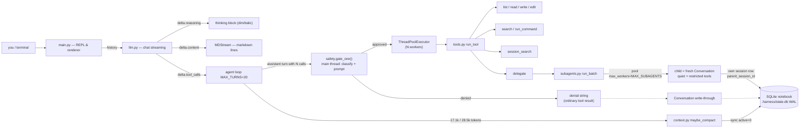

# The Harness — Documentation Index

A minimal but complete **agentic coding harness**: a CLI coding agent written in
Python, built phase by phase with [Hermes-agent] as the reference design.
Stdlib-first, one OpenAI-compatible model endpoint, ~1800 lines total.

```
config.py       42   every setting, read from .env          phase 1
messages.py     51   Conversation (write-through memory)    phase 1 + 6
llm.py         151   the ONLY file that talks to the model  phases 1, 5, 7
safety.py      474   permission gate, modes, guards         phase 4
tools.py       237   tool registry, runner, schemas         phases 2, 3, 6, 8
main.py        307   agent loop + REPL + streaming UI       phases 1, 2, 7
context.py     189   two-tier context management            phase 5
sessions.py    235   SQLite notebook (the archive)          phase 6
subagents.py   153   parallel child agents                  phase 8
                 ─
               1839
```

## Phase documents

| Doc | Phase | Built | Verified |
|---|---|---|---|
| [phase_1.md](phase_1.md) | Foundation | venv, `.env`, config / llm / messages / minimal loop | ✔ streaming round trip |
| [phase_2.md](phase_2.md) | Agent loop + tool calling | `SCHEMA`, `REGISTRY`, `run_tool`, error recovery | ✔ tool call + self-repair |
| [phase_3.md](phase_3.md) | Real coding tools | path jail, caps, search, shell | ✔ incl. secret refusal |
| [phase_4.md](phase_4.md) | Safety gate | `safety.py`: tiers, modes, hardline, rules, guards | ✔ unit probes (no server) |
| [phase_5.md](phase_5.md) | Context management | prune@45%, LLM summary@75%, archive-not-delete | ✔ live compaction |
| [phase_6.md](phase_6.md) | Sessions | SQLite notebook, write-through, resume, search | ✔ crash-resume + lineage |
| [phase_7.md](phase_7.md) | Streaming UI + thinking | OpenCode-style renderer, `delta.reasoning` routing | ✔ thinking block |
| [phase_8.md](phase_8.md) | Subagents + parallel calls | `delegate`, 2-level parallelism, thread-local state | ✔ 4 children side by side |

## The nine rules the code never breaks

1. **`llm.py` is the only file that talks to the model.** Summaries, children,
   the parent loop — everything goes through `chat()`.
2. **The history list is the source of truth; storage mirrors it.** `Conversation`
   writes through to SQLite; `sync()` reconciles after compaction. There is no
   second copy of "the truth".
3. **Errors are strings, never exceptions** crossing back to the model. The
   protocol always stays valid and the model can route around its own mistakes.
4. **Every tool result is capped** (4000/5000 chars). An uncapped `find .` once
   blew the window; the caps are load-bearing.
5. **Archive, never delete.** Compaction marks rows `active=0`; pruned tool
   output, old turns, and child transcripts all stay reachable via
   `session_search`.
6. **Thread-scoped state is thread-local.** Tool restriction and quiet flags
   live in `threading.local()` — parallel children cannot corrupt each other.
7. **Tool results go back in call order** (assistant `tool_calls[i]` ↔ `tool[i]`),
   even when they *finish* out of order in the parallel executor.
8. **Children know only goal + context.** No parent conversation, no `delegate`
   tool at depth ≥ `MAX_SPAWN_DEPTH`, results trimmed to a summary + session id.
9. **Every tool call passes the safety gate before execution.** `safety.gate_one()`
   runs on the main thread before the executor; `run_tool()` re-applies the
   static policy for children. Hardline commands never run, in any mode.

## Whole-system picture



## Key numbers & safety knobs

| Knob | Value | Meaning |
|---|---|---|
| `CONTEXT_LIMIT` / `RESERVE` / `BUDGET` | 50000 / 12000 / 38000 | window, protected output room, usable conversation |
| `PRUNE_AT` | 45% of budget (≈17.1k) | tier 1: stub old tool outputs (free) |
| `COMPACT_AT` | 75% of budget (≈28.5k) | tier 2: LLM summarizes the middle |
| `KEEP_HEAD` / `KEEP_TAIL` | 3 / 6 | messages protected verbatim (Hermes protect_first/last_n) |
| `RECENT_TURNS_TO_KEEP` | 6 | newest tool turns never pruned |
| `MAX_TURNS` (main loop) | 20 | tool rounds before forced stop |
| `MAX_SUBAGENTS` | 3 | children per delegate call (Hermes: 10) |
| `SUBAGENT_MAX_TURNS` | 12 | child tool rounds |
| `SUBAGENT_SUMMARY_CHARS` | 8000 | child → parent summary cap (head 75% / tail 25%) |
| `MAX_SPAWN_DEPTH` | 1 | flat: children cannot delegate (Hermes default) |
| tool result caps | 4000 / 5000 | per-tool / global backstop |
| `max_tokens` (llm.py) | 4096 | output + reasoning headroom |
| safety mode | `ask` (default) | `ask` / `auto` / `plan`; switch with `/mode` or `/yolo` |
| allow rules | `.harness/safety.json` | persistent `bash:<glob>` / `tool:<name>` answers |
| hardline blocklist | always on | no mode or rule can disable it |

## Working conventions

- **Run with `.venv/bin/python`** — `python`/`python3` are not on this shell's PATH.
- **Ad-hoc probes** go in `test/` (`test_model.py`, `test_tool_call.py`, …):
  small scripts that hit the server directly, one behavior each.
  `test/test_safety.py` is the offline exception — pure policy checks, no server.
- **`.harness/state.db`** is the notebook (gitignored); `/export` writes JSONL
  next to it. **`.harness/safety.json`** holds the persisted mode + allow rules.
- **`.env` holds a rotating trycloudflare `BASE_URL`** — update it when the
  tunnel dies; `MODEL` is whatever the Ollama-family server serves.

## Suggested reading order

Read phase docs in order — each one states *what problem it solved, the design
choices with rejected alternatives, diagrams of the mechanism, and how it was
verified*. Phase 4 covers the safety gate (tiers, modes, hardline floor,
persistent rules, guards). Phase 8 is the largest: subagents, thread-local
state, and the two-level parallelism that lets the agent run several children
at once.
