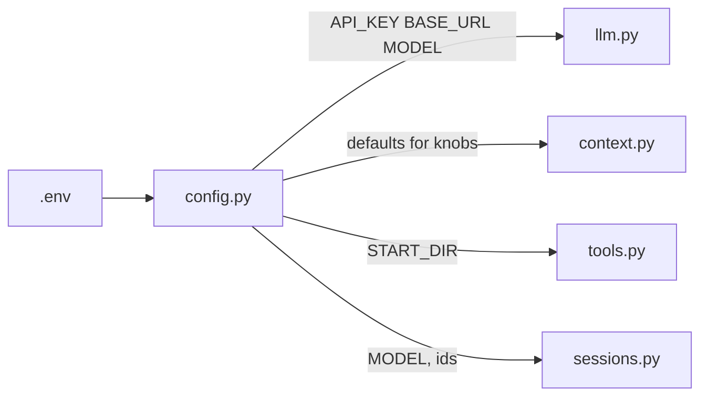
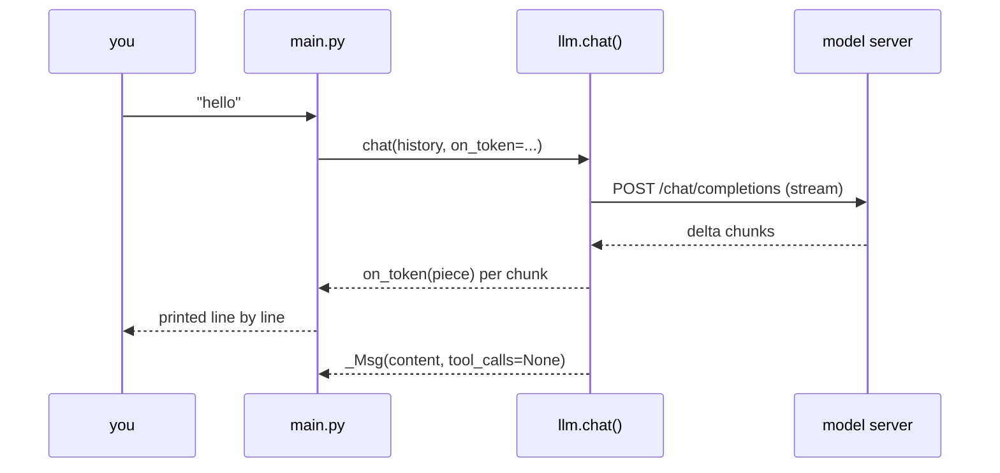

# Phase 1 — Foundation

**Problem:** nothing exists yet. This phase builds the shortest path to a model
that answers, plus the structure every later phase hangs on.

**Deliverable:** a REPL where you type a line and the model streams an answer
back — with settings in one place, the conversation in one list, and exactly one
file allowed to touch the network.

---

## Environment

| Piece | Choice | Why |
|---|---|---|
| Python | `.venv` (python 3.14) inside the project | reproducible; `python` isn't on PATH — always `.venv/bin/python` |
| Secrets/config | `.env` next to `config.py`, loaded by `python-dotenv` | never committed; one place to swap endpoints |
| Endpoint | OpenAI-compatible (Ollama-family behind a rotating trycloudflare tunnel) | the harness doesn't care *who* serves the API — see `BASE_URL` |
| Dependencies | `openai` + `python-dotenv` only | everything else stdlib |

`.env` today:

```
OPENAI_API_KEY=ollama                 # server ignores it; the SDK demands one
BASE_URL=https://<rotate>.trycloudflare.com/v1   # update when tunnel dies
MODEL=k2-horizon-mova-36b-a4b
```

---

## File 1: `config.py` — every knob, one file

```python
ROOT = Path(__file__).resolve().parent
load_dotenv(ROOT / ".env")          # works from any cwd

def _get(name, default=""): return os.getenv(name, default).strip()
```

- `_get()` + `int()` is the whole config system — no YAML, no dataclasses.
  Defaults are written *in the code*, so the file documents itself.
- `START_DIR = ROOT` — the project folder is pinned here, and **every** file tool
  and shell command resolves against it (phase 3 builds the jail on this line).
- `require_api_key()` turns a missing/placeholder key into a friendly 3-step
  message instead of an `OpenAIError` traceback.

Mermaid — what depends on what (this graph only *grows* in later phases):



## File 2: `llm.py` — the only file that talks to the model

Phase 1 signature (later phases only ever *add parameters*):

```python
def chat(messages, tools=None, model=None, on_token=None, on_thinking=None) -> _Msg
```

Three decisions made here that every later phase relies on:

1. **One entry point.** Compaction summaries (phase 5) and child agents
   (phase 8) call this same function — they get streaming, tool support, and
   usage accounting for free.
2. **Own mini-classes `_Msg` / `_TC` / `_Fn`** instead of the SDK's pydantic
   messages:
   - streamed tool calls arrive as *fragments* (`id`, `name`, `arguments` drip
     across chunks, indexed by `index`) — we must reassemble them ourselves;
   - `.model_dump()` gives exactly the dict shape `messages.py` stores;
   - the OpenAI SDK stays an implementation detail of this one file.
3. **`_last_usage` module dict** updated from `stream_options.include_usage`.
   The REPL status line reads it without plumbing usage through every return
   value.



## File 3: `messages.py` — `Conversation`

```python
class Conversation:
    def __init__(self, system_prompt, session_id=None):
        self.history = [{"role": "system", "content": system_prompt}]
```

- The history is a **plain list of dicts in wire format** — exactly what the
  API expects. Easy to inspect, slice, and rewrite (phase 5 does rewrite it).
- Phase 1: `add_user` / `add_assistant` only append. Phase 6 turns them
  *write-through* (each add also inserts a SQLite row) — the class is the seam
  where persistence later attaches without changing callers.
- `default_system_prompt()`: `"You are a coding agent. ... Inspect before acting.
  If a tool errors, adjust and retry. Be concise."` — the middle sentence is
  seed language for phase 2's error-recovery design.

## File 4: `main.py` — the minimal loop

```python
convo.add_user(msg)
reply = chat(convo.history)
convo.add_assistant(reply)
print(reply.content)
```

The `for _ in range(MAX_TURNS)` shape existed from the start; in phase 2 the
`if reply.tool_calls:` branch gets a body, and the `else` branch (no tools) stays
this plain print.

---

## Design choices of this phase

| Decision | Rejected alternative | Reason |
|---|---|---|
| conversation = list of dicts | `Message` objects with fields | wire format is the memory; objects would need serialization everywhere |
| `_Msg` assembled by us | trust SDK response objects | fragmented streaming tool calls need reassembly regardless |
| settings read once at import | read env inside each function | consistent snapshot; trivially testable |
| friendly missing-key error | let the SDK raise | first-run experience is the product |
| `START_DIR` from `__file__` | `os.getcwd()` | tools behave the same no matter where you launched from |
| one `chat()` for all purposes | separate simple/streaming functions | one function to fix when the server misbehaves |

## Verification (checkpoint)

- `test/test_model.py`: streaming round trip through the live tunnel — tokens
  arrive one by one, `usage` captured into `_last_usage`.
- This established the probe pattern reused every phase: a throwaway script in
  `test/` that exercises *one* behavior against the real server before the REPL
  code is trusted.
