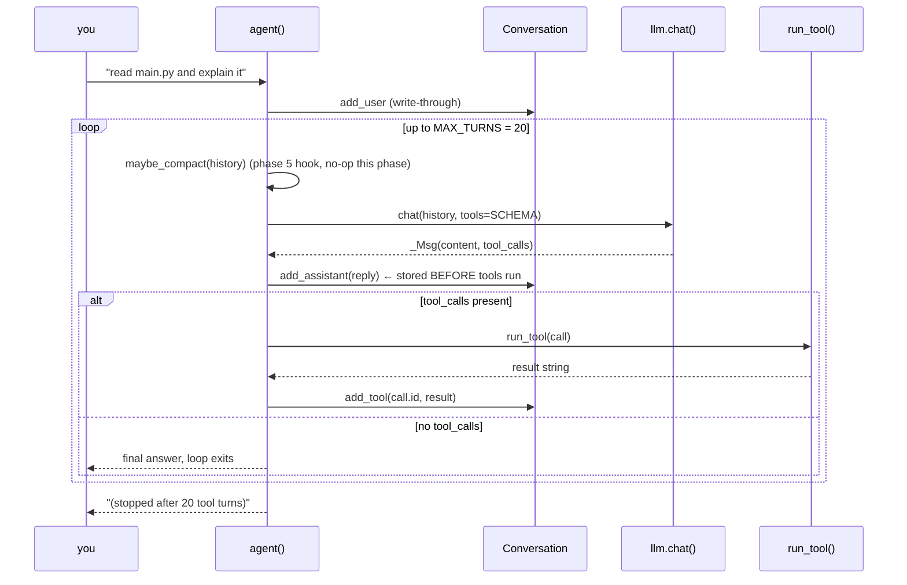

# Phase 2 — Agent Loop + Tool Calling

**Problem:** a chat bot can only talk. Give it hands: the model may request
functions, see their results, and keep acting until it answers without tools.

**Deliverable:** the canonical loop (`SCHEMA` out → `tool_calls` back → run →
`tool` message → repeat) — plus the two philosophical rules that make it survive
a confused model: *errors are strings*, and *the loop always terminates*.

---

## The three pieces

```mermaid
flowchart LR
    subgraph "tools.py"
        SC[SCHEMA<br/>OpenAI JSON specs] -->|sent every chat()| S[server decides]
        R[REGISTRY<br/>name → function] -->|dispatch| RT[run_tool]
    end
    subgraph "main.py"
        L[agent loop] -->|tools=SCHEMA| SC
        S -->|reply.tool_calls| L
        L -->|call| RT
        RT -->|result string| L
    end
```

### 1. `SCHEMA` — what the model may ask for

Built by two tiny helpers so each tool is 3–6 lines instead of 15:

```python
def _tool(name, description, params=None, required=None): ...
def _str(desc=""): return {"type": "string", "description": desc}
```

Example entry:

```json
{"type":"function","function":{
   "name":"edit_file",
   "description":"Search-and-replace exact text inside a file.",
   "parameters":{"type":"object",
     "properties":{"path":{"type":"string","description":"file path"},
                   "old_string":{"type":"string","description":"exact text to replace (must be unique)"},
                   "new_string":{"type":"string","description":"replacement text"}},
     "required":["path","old_string","new_string"]}}}
```

The descriptions are **prompt engineering**: `"must be unique"` in phase 3 makes
the model quote larger context when its edit target is ambiguous.

### 2. `REGISTRY` — name → function

Plain dict. No classes, no decorators, no registration magic:

```python
REGISTRY = {"list_files": list_files, "read_file": read_file, ...}
```

Phase 8's `delegate` lands here as one more entry — the registry design meant
tools are additive with zero loop changes.

### 3. `run_tool(call)` — the single runner

```python
def run_tool(call) -> str:
    args = json.loads(call.function.arguments or "{}")   # arguments = a JSON string
    try:
        result = REGISTRY[name](**args)
    except Exception as e:
        result = f"Error: {e}"        # errors go back so the model can recover
    result = str(result) or "(no output)"
    if len(result) > 5000:            # safety net: never blow the context window
        result = result[:5000] + "\n...[truncated]"
    return result
```

Three guarantees, all visible above:

| Guarantee | Mechanism | Failure it prevents |
|---|---|---|
| never crash the turn | `except` → `"Error: {e}"` | one bad path kills the whole conversation |
| never overflow context | 5000-char global cap | a `find .` dumping megabytes into history |
| always a string | `str(result)` | dict/list results the API rejects |

## The loop in `main.py`



Notes on the ordering:

- **`add_assistant` happens before tools run** — a crash mid-tool leaves a
  truthful transcript (assistant asked, no answer yet), which phase 6's
  interrupted-turn detection keys off.
- **`add_tool` is keyed by `call.id`.** The API *requires* every
  `tool_calls[i].id` to get a matching `role:"tool"` message or the next request
  400s. Phase 8's parallel executor must preserve this order — it's the
  invariant everything else bends around.
- **`maybe_compact` at the top of every turn** — inserted in phase 5 with two
  lines; the loop shape never changed.

## Why errors are strings, not crashes

The system prompt already says *"If a tool errors, adjust and retry."* Feeding
`"Error: file not found: mian.py"` back as a normal tool result lets the model
**fix its own typo** on the next round — no user intervention. It also keeps the
message list schema-valid: the tool reply exists, the protocol holds, and the
next `chat()` call succeeds. This pattern was reused everywhere:
`edit_file` non-unique errors, secret refusals (phase 3), approval denials
(planned phase 4), unavailable-tool errors (phase 8).

## Why `MAX_TURNS = 20`

Heuristics have no exit condition — a confused model can `list_files` forever.
20 tool-rounds is plenty for real work and small enough that a stuck session is
obvious within seconds. On cap, we return a *string* (`"(stopped after 20 tool
turns)"`) so the turn still ends in a valid assistant message.

## Evolution markers

Two later changes touch this phase's code — documented where they happened:

- **Sequential → parallel tool execution** ([phase_8](phase_8.md)): when the
  model emits several `tool_calls` in one turn, they now run in a
  `ThreadPoolExecutor`, results collected by index, replayed to the model in
  original call order.
- **Thinking tokens** ([phase_7](phase_7.md)): `chat()` grew `on_token` /
  `on_thinking` callbacks; the loop body around `chat()` gained the thinking
  indicator and markdown renderer.

## Verification (checkpoint)

- `test/test_tool_call.py` / `test/see_tool_calls.py`: model emits a structured
  `read_file` call, arguments parse, result flows back, final answer contains
  real file content.
- Deliberate typo path (`read_file "mian.py"`) → `"Error: ..."` → model retried
  with the correct spelling **in the same session, without user help** — the
  error-recovery rule proven live.
