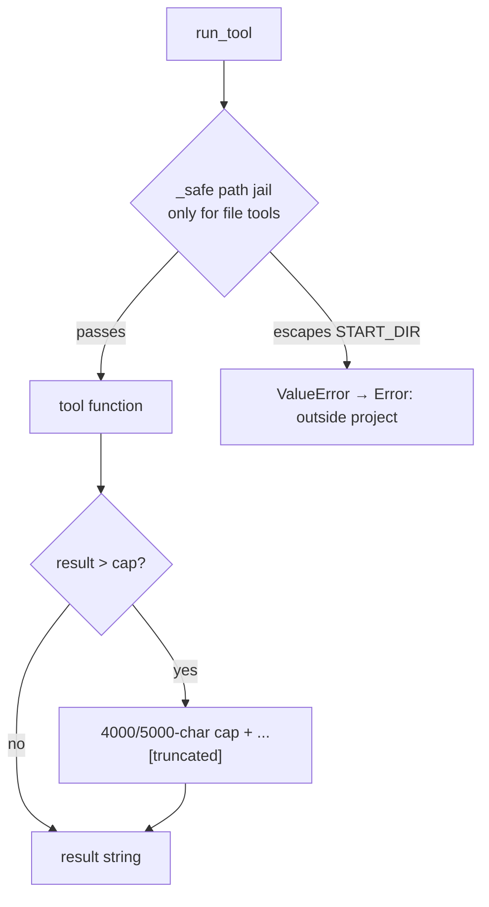

# Phase 3 — Real Coding Tools

**Problem:** the loop works but the agent has no hands. Give it the six tools a
coding agent actually needs — and make every one of them *safe to hand to a
model that makes mistakes*.

**Deliverable:** `list_files`, `read_file`, `write_file`, `edit_file`,
`search_files`, `run_command` in `tools.py`, plus the two safety mechanisms
(`_safe()` path jail, output caps) that all later tools inherit — including
`session_search` (phase 6) and `delegate` (phase 8).

---

## The tool set



| Tool | Params | Behavior highlights | Cap |
|---|---|---|---|
| `list_files` | — | walks `START_DIR`, skips `SKIP_DIRS` + any dotted part | 4000 |
| `read_file` | path | full UTF-8 text; **refuses secrets** (below) | — |
| `write_file` | path, content | `mkdir(parents=True)`; reports `created` vs `overwrote` + char count | — |
| `edit_file` | path, old_string, new_string | exact-unique replace or refuse | — |
| `search_files` | needle | line-numbered hits in whitelisted extensions; stops after 50 hits | 50 hits |
| `run_command` | command | shell, `cwd=START_DIR`, timeout 60 s, stderr + `[exit=N]` | 4000 |

Two module-level constants decide where tools may walk:

```python
SKIP_DIRS   = {".venv", "__pycache__", ".git"}
SEARCH_EXTS = {".py", ".md", ".txt", ".json", ".toml", ".yaml", ".yml",
               ".cfg", ".ini", ".sh", ".env.example"}
```

`SEARCH_EXTS` keeps searches off binaries and `.venv` dumps; `SKIP_DIRS` keeps
`list_files` output small enough to be *useful* — a listing of 12k venv files
helps nobody.

## The path jail — `_safe()`

```python
def _safe(path: str) -> Path:
    p = (START_DIR / path).resolve()      # normalizes ../, absolute, symlinks
    if not str(p).startswith(str(START_DIR)):
        raise ValueError(f"outside project: {path}")
    return p
```

- **Every** filesystem tool (`read/write/edit`) calls it before touching disk.
- `resolve()` collapses `../../etc/passwd` and absolute paths *before* the
  comparison, so traversal attempts are caught, not executed.
- Failure raises → `run_tool` catches → model gets
  `"Error: outside project: ..."` and can retry with a legal path.
- **Accepted trade-off:** an already-existing symlink *inside* the project
  pointing outside would resolve to its target and slip through. Not handled —
  there is no untrusted remote input writing symlinks here; a `lstat` audit would
  be complexity for a threat this harness doesn't face.

## Size caps — a two-layer history

| Layer | Where | Limit | Origin |
|---|---|---|---|
| per-tool | `list_files`, `run_command` | 4000 chars | a `find .` once dumped a huge tree straight into history |
| global | `run_tool` | 5000 chars + `...[truncated]` | backstop for any tool, present or future |
| temporal | `context.py` (phase 5) | old results get stubbed at 45% | the *long-term* answer |

Why both layers: the global cap in `run_tool` protects the *next message*, but
a 4000-char result stored 30 turns ago still sits in history — phase 5's prune
level later removes it from the *window*. Tool caps were added only after the
uncapped `find .` overflow proved per-turn growth alone can break the session.

## `edit_file` — exact-unique or refuse

```python
count = text.count(old_string)
if count != 1:
    return f"error: old_string appears {count} times in {path} (need exactly 1 — add more context around it)"
```

| | exact-unique (chosen) | fuzzy match (Claude Code style) |
|---|---|---|
| wrong-edit risk | zero (refuses) | small but real |
| code size | ~8 lines | fuzzy-diff engine |
| recovery path | model adds context, retries | silent near-matches |
| failure UX | error message doubles as instruction | must guess intent |

The error text is deliberately written *to the model* — it tells the model
exactly how to fix its own input. This "errors as instructions" style is the
phase-2 rule applied to tool design.

## `run_command` details

```python
r = subprocess.run(command, shell=True, cwd=START_DIR,
                   capture_output=True, text=True, timeout=60)
out = r.stdout.strip()
if r.stderr.strip(): out += "\n[stderr] " + r.stderr.strip()
out += f"\n[exit={r.returncode}]"
```

- `cwd=START_DIR` pinned — commands run in the project folder no matter where
  the REPL was launched (predictability beats convenience).
- `[exit=N]` always appended: the model learns *success*, not just output —
  `py_compile` failures are visible even when stderr is empty.
- `timeout=60` — a hung command becomes an error string the model can react to,
  never a frozen REPL.
- **Caveat (known, deliberate):** no persistent shell — each call is a fresh
  process, so `cd x && ...` state does not survive across calls, and
  `run_command("... &")` background processes are not tracked. Phase-4-style
  hardening and a persistent shell are on the deferred list.

## Secrets — `read_file` refuses

```python
BLOCKED_FILES = {".env"}
if p.name in BLOCKED_FILES or p.suffix in (".key", ".pem"):
    return "error: refusing to read a secret file"
```

A *string* refusal, not an exception — the model sees a rule it must respect
("don't ask for secrets again"), not a crash. Blocks `.env` by name and
`.key`/`.pem` by suffix. `read_file` runs **after** `_safe()`, so the jail and
the secret block are independent lines of defense.

## Design choices

| Choice | Rejected alternative | Reason |
|---|---|---|
| caps at 4000/5000 | no caps "until needed" | the overflow already happened once; caps are permanent |
| `_safe()` inside each file tool | a wrapper decorator | 3 call sites; an explicit first line is readable and impossible to forget |
| search whitelist of extensions | search everything | binary hits are noise; `.env.example` is whitelisted while `.env` is not |
| `edit_file` unique-or-refuse | fuzzy matching | zero wrong-edit risk for ~8 lines of code |
| `[exit=N]` / `[stderr]` in shell results | raw stdout only | the model must know *whether* it worked |
| errors as return strings | raise + catch in loop | tool body decides its own error wording |

## Verification (checkpoint)

- agent asked "what's in the project?" → used `list_files`, answered from output
- `read_file(".env")` → `error: refusing to read a secret file`
- `edit_file` with an ambiguous short string → refused with `appears N times`,
  model re-issued with more context → accepted
- `run_command("python -m py_compile main.py")` → `[exit=0]` teaches the agent
  its edits are syntactically valid
- `find .` through `run_command` → hit the 4000 cap instead of the window limit
  (the incident that created the caps)
