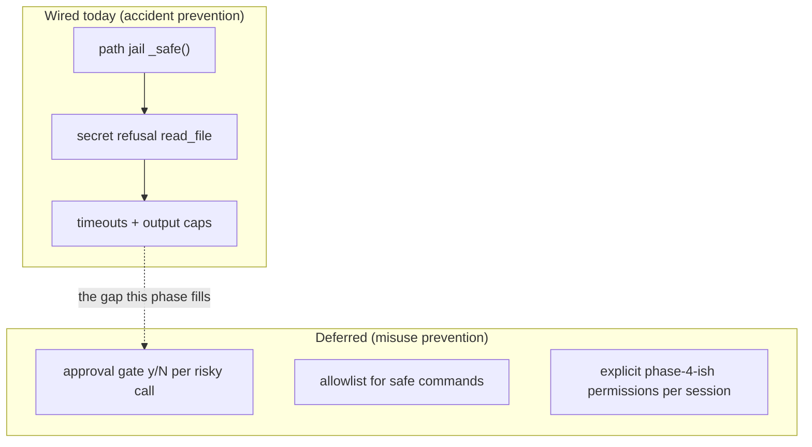
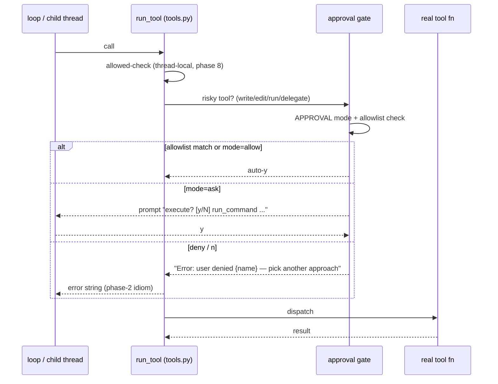

# Phase 4 — Safety & Approvals (designed, deliberately deferred)

**Status:** 🔶 **design only — nothing wired.** This was a theory phase: work
out *where* an approval gate belongs and *what* it must decide, then consciously
choose to finish the capability phases first and bolt safety on when there's a
working agent to protect.

This doc exists so the eventual wiring is mechanical, not research.

---

## Honest risk table — what the agent can do *right now* without asking

| Tool | Can damage | Protected today by |
|---|---|---|
| `write_file` | overwrite any file in project | path jail only |
| `edit_file` | corrupt any file | path jail + unique-match |
| `run_command` | **anything shell can do** (`rm -rf`, network, git) | cwd pin + timeout + output cap |
| `delegate` (phase 8) | all of the above × N children | children inherit the same tools |
| `read_file` | reads secrets | explicit `.env`/`.key`/`.pem` refusal |



The honest summary: today's guards stop a **careless** agent; only the deferred
gate stops a **wrongly-instructed or confused** one.

## The planned design

### Where the gate sits



The prompt lives **inside `run_tool`** — one interception point that both the
parent loop and every child thread pass through. The REPL owns `input()` (only
the main thread may block on stdin); children would resolve through an
allowlist/auto-deny path so a blocked `input()` in a pool thread can never hang
a parallel batch.

### Planned config knobs (`config.py` / `.env`)

```python
APPROVAL    = "ask"    # ask | allow | deny — default posture
ALWAYS_ASK  = {"write_file", "edit_file", "run_command", "delegate"}
ALLOWED_BASH = [       # pre-approved prefixes; never matches rm/curl-pipe
    "python -m py_compile", "python -c", "pip install", "ls ", "grep ",
]
```

- **allowlist before ask**: `py_compile` on a file the agent just edited is a
  *verification* step — forcing a keystroke for it trains users to mash `y`,
  which defeats the gate. Only genuinely risky calls deserve a prompt.
- **deny mode**: run the agent read-only — useful for delegating review tasks
  where children must not write.
- Denial is always a **string error**, so the model can respond ("the user
  declined the overwrite; I'll ask first") — same recovery path as phase 2.

### Why deferred (the reasoning, recorded)

1. **Order of value:** a gated agent that can't compact/resume/subagent is a
   demo; an ungated agent that does all three is a *tool you can finish
   hardening*. Wiring safety last means the gate wraps the **final** tool set —
   including phase 8's `delegate`, which would otherwise need retrofitting.
2. **Teaching sequence:** the goal was to build and verify one mechanism per
   phase. Safety is cross-cutting (touches every tool, every thread) — mixing it
   into early phases would have blurred their lessons.
3. **The thread model had to exist first.** Approval in a *parallel* world needs
   thread-local semantics (which thread blocks? what do children do?). Phase 8
   created that world; phase 4's design now has a concrete place to sit.

## What wiring it later will touch (checklist)

- [ ] `config.py`: `APPROVAL`, `ALWAYS_ASK`, `ALLOWED_BASH`
- [ ] `tools.py`: gate call inside `run_tool`, after the allowed-check
- [ ] `main.py`: thread-safe prompt (queue from worker threads → main thread)
- [ ] `subagents.py`: children inherit policy (`deny` mode for review delegations)
- [ ] `/` command: flip posture live (`/approve ask|allow|deny`)
- [ ] sessions: log every decision (which call, approved/denied) into the notebook

## Verification

— none, by design. Nothing in this phase shipped; no behavior changed.
