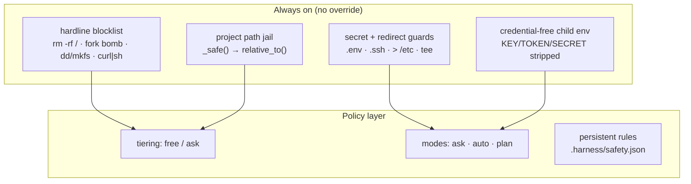
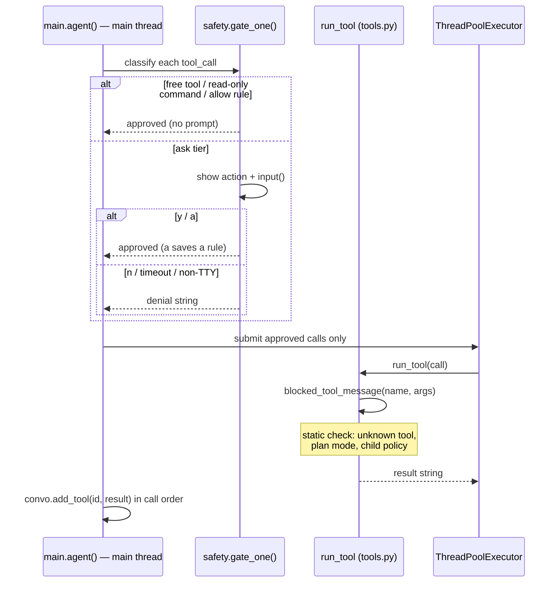

# Phase 4 — Safety & Approvals (implemented)

**Status:** ✅ **wired.** The gate lives in `safety.py` and is called from
`main.agent()` before tool dispatch; `tools.run_tool()` re-checks the static
policy so child threads inherit it. The design was drafted early and deliberately
built after the capability phases, so it wraps the final tool set — including
`delegate` (phase 8) — instead of being retrofitted.

---

## What is now protected

| Tool | Can damage | Gate |
|---|---|---|
| `read_file` | reads secrets | path jail + secret refusal + private-key sniff |
| `write_file` | overwrite any file in project | path jail + secret refusal + approval |
| `edit_file` | corrupt any file | path jail + unique-match + secret refusal + approval |
| `run_command` | **anything shell can do** | hardline floor + read-only detection + guards + approval |
| `delegate` | all of the above × N children | parent approval; children inherit static policy |



The honest summary: the guards stop a **careless** agent; the approval gate
stops a **wrongly-instructed or confused** one. Neither is a substitute for an
OS/container sandbox against a hostile agent.

## Where the gate sits

Approval prompts must run on the **main thread**. Tool calls in one assistant
turn are dispatched to a `ThreadPoolExecutor`, so the gate runs *before* the
pool: each call is classified and (if needed) prompted sequentially, then only
the approved calls are submitted.



Children never call `input()`: a `delegate` call is approved as a batch at the
parent, and each child's `run_tool` applies the same static policy (unknown
tools refused; plan mode refuses writes/exec; hardline and guards run inside
`run_command`). Denials are ordinary **string** tool results — the same
error-recovery idiom as phase 2 — so the model can adjust instead of crashing.

## Tool tiers

```python
FREE_TOOLS = {"list_files", "read_file", "search_files", "session_search"}
ASK_TOOLS  = {"write_file", "edit_file", "run_command", "delegate"}
```

Reads are free because the path jail and secret checks already constrain them.
Unknown tool names are refused (allowlist by default).

## Modes (persisted in `.harness/safety.json`)

| Mode | Behavior |
|---|---|
| `ask` (default) | free tools run; ask tier prompts `[y] once / [a] always / [n] no` |
| `auto` | skip prompts; hardline, path, secret, redirect, and env guards still run |
| `plan` | read-only tools and read-only shell only; writes/exec/delegate refused |

`/mode` switches, `/yolo` toggles `ask ↔ auto`, `/safety` inspects.

## Read-only shell detection

`run_command` is free only when **every** compound part is read-only:

- Split on `&&`, `||`, `;`, `|`, `&` — so `git status && rm -rf build` still asks.
- Strip known wrappers (`timeout`, `nice`, `nohup`, `stdbuf`, `xargs`, `env`)
  and safe env assignments; unknown assignments make the command ask.
- Recognise a read-only set (`ls`, `cat`, `grep`, `head`, `tail`, `wc`, `diff`,
  `find`, `sed` without `-i`, `git status/log/diff/...`).
- `cd` must stay inside the project; absolute/`..`/`~` read paths outside the
  project make the command ask.
- Redirects (`>`, `>>`, `<`) and `tee` are never read-only — they are checked
  as writes.

## Persistent rules

Saving an "always" answer appends to `.harness/safety.json`:

```json
{
  "mode": "ask",
  "allow": ["bash:npm test*", "tool:write_file"]
}
```

- `bash:<glob>` — matched per compound part (`fnmatch`, case-insensitive).
- `tool:<name>` — whole tool pre-approved.
- Manual management: `/allow bash:git push*`, `/unallow ...`.
- A compound command is auto-approved only if **each** part is read-only or
  matches a rule — an allow rule can't smuggle `rm -rf` behind `npm test`.

## Guards

- **Hardline blocklist** — `rm -rf /` and variants, `--no-preserve-root`, fork
  bombs, raw disk writes (`dd`/`mkfs`), `curl | sh`, recursive `chmod 777 /`,
  shutdown/reboot. Refused before any prompt, even in `auto`.
- **Path jail** — `_safe()` resolves and calls `relative_to(START_DIR)`, which
  rejects both `..` escapes and sibling-prefix tricks (`project-evil`).
- **Secrets** — `.env*` (except `.env.example`), `.pem`, `.key`, `credentials`,
  `.ssh/`, `.aws/`, etc. refused on read, write, edit, search, and in shell
  mentions (`cat .env`, `--env-file=.env`). File contents containing a private
  key header are refused too.
- **Redirect/`tee` targets** — must resolve inside the project and not be a
  secret; `~`, `$VAR`, and absolute paths are resolved or rejected.
- **Environment scrub** — subprocesses receive a filtered environment; names
  containing `KEY`, `TOKEN`, `SECRET`, `PASSWORD`, `AUTH`, or `CREDENTIAL` are
  dropped, so `run_command("printenv")` cannot exfiltrate the model key.

## What is *not* done

- Approval decisions are shown in the UI but **not logged to SQLite**; the
  notebook currently stores messages only.
- The policy file is global to the project, not per session.
- These are app-level checks. `shell=True` in `run_command` means a determined
  agent can still reach the host (e.g. an interpreter script that opens files).
  Real isolation requires an OS sandbox — bubblewrap / Docker / VM — around the
  whole process; see the README's Safety section.

## Verification

Unit probes (`test/test_safety.py`, no model server needed — 39 assertions):

- hardline: `rm -rf /`, fork bomb, `curl | sh` → refused; `rm -rf build` → not hardline
- read-only: `ls -la`, `cat file | grep x`, `git status` → free;
  `git push`, `rm -rf`, `git status && rm -rf build` → ask
- paths: `cat /etc/passwd`, `cd /tmp`, `find /` → ask; `ls > /dev/null` → free
- redirects: `> /etc/passwd`, `> ~/evil`, `> $HOME/evil` → blocked
- secrets: `cat .env`, `python --env-file=.env` → blocked; `.env.example` → allowed
- modes: plan allows reads/read-only shell, refuses writes; auto allows writes
  but still refuses hardline commands
- persistence: `[a]lways` writes `tool:write_file` / `bash:<part>` rules; reload
  restores mode + rules
- fail-closed: non-TTY prompt without a rule → denial string
