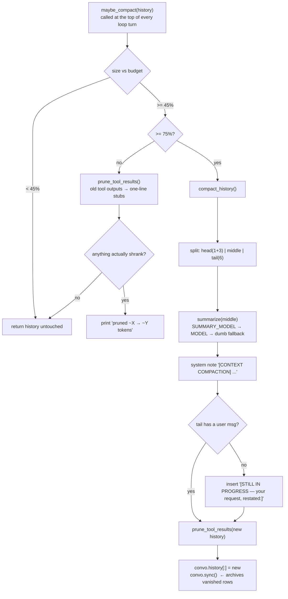
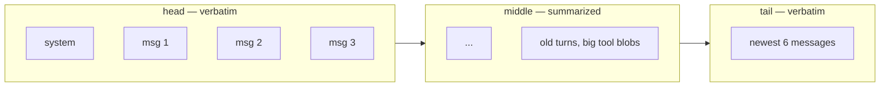
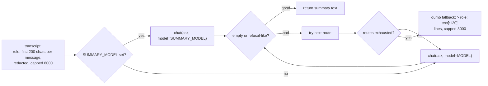

# Phase 5 — Context Management

**Problem:** the model has a fixed window (50 000 tokens). A coding session —
big file reads, search dumps, tool trees — blows it in minutes. What do you
throw away, and when?

**Deliverable:** `context.py` — Hermes-style **two-tier compaction**: a free
level that stubs old tool outputs, and a summary level that replaces the old
middle of the conversation with a note. Nothing is ever deleted: whatever leaves
the window stays archived in the notebook (phase 6's `sync()`), searchable via
`session_search`.

> *"The model has NO memory. Whatever WE send it IS its memory. So we are
> allowed to rewrite old messages."* — `context.py` docstring, the phase's motto.

---

## The budget

```
CONTEXT_LIMIT    50 000   the model's window
CONTEXT_RESERVE  12 000   always left free: output + reasoning + next tool blob
CONTEXT_BUDGET   38 000   what the history may occupy     ← the measuring stick
```

| Tier | Trigger | Cost | What it does |
|---|---|---|---|
| **1 — PRUNE** | ≥ 45% of budget (≈17.1k tokens) | free, no LLM | stub old tool outputs to one line |
| **2 — COMPACT** | ≥ 75% of budget (≈28.5k tokens) | one LLM call | summarize the old middle, keep head+tail verbatim |

Token counting is a deliberate approximation:

```python
def tokens(text): return len(str(text or "")) // 4   # ~4 chars per token
```

No tokenizer dependency. At a 50k window the ±15 % error only shifts when a
tier fires — and `COMPACT_TO = 0.60` (compact down to 60 %) means one deep cut,
not ten nervous ones at the margin.



## Tier 1 — prune (free, no LLM)

```python
RECENT_TURNS_TO_KEEP = 6     # newest tool turns stay untouched
PRUNE_MIN_CHARS      = 200   # stubbing a 50-char result saves nothing
```

Walking **newest → oldest**, counting assistant-tool-call turns as rounds: after
the newest 6 rounds, every tool message ≥200 chars becomes:

```
[Old tool output cleared — 4321 chars, recover via session_search]
```

- The **pointer is load-bearing**: `sync()` (phase 6) archives the original row
  with `active=0`, so `session_search` still finds the bytes. Pruning relocates
  information; it doesn't destroy it.
- Recent 6 rounds stay verbatim because they're *working memory* — the last
  file the agent read is usually the file it's editing now.

## Dividing: head | middle | tail



- `KEEP_HEAD = 3`, `KEEP_TAIL = 6` — Hermes's `protect_first_n` / `protect_last_n`.
  Head keeps the original task framing; tail keeps the current work.
- **Protocol rule:** the tail must not *start* with a `role:"tool"` message — a
  tool result belongs to the assistant turn before it, and cutting between them
  creates an invalid conversation (the API would 400). `split_history()` walks
  that assistant turn down into the tail to reunite the pair:

```python
while tail and tail[0].get("role") == "tool" and middle:
    tail.insert(0, middle.pop())      # reunite the pair
```

- Too-small histories (`≤ 1+3+6` messages) return `(head, [], [])` — never
  summarize a conversation that has barely started.

## Tier 2 — the summary (with a fallback ladder)



- **Sectioned instruction** — the model is told to produce exactly:
  `## Active Task / ## Done / ## Files & Findings / ## Errors / ## Next Steps`,
  keeping the user's goal verbatim and writing `[REDACTED]` for secrets.
- **Redaction** happens *before* the transcript reaches the summarizer
  (`SECRET = re.compile(r"sk-[A-Za-z0-9_-]{8,}")` → `[REDACTED]`) — an API key
  in an old tool output must not leak into a new message.
- **"Bad" detection**: empty answer or one starting with `sorry / i can't /
  i cannot` → count as failure, try the next route. Never inject a refusal as a
  compaction note.
- **Dumb fallback** always produces *something*: one line per message. Ugly but
  structured — better than an empty window.

## Assembly — `compact_history()`

```
new_history = head + [ [CONTEXT COMPACTION] system note ] + tail
```

The note is a `role:"system"` message so it can't be mistaken for user
instruction, prefixed with *"Earlier turns were replaced by this note. Treat it
as background. Keep working normally with your tools."*

**User-replay rule:** if no `role:"user"` survives in the tail (the request that
launched all this work is itself in the middle), the newest user message from the
middle is re-inserted right after the note:

```
[STILL IN PROGRESS — your request, restated:]
...original user message...
```

Without this the model compacts away its own task and answers "…and what was I
doing?". Finally the assembled history gets `prune_tool_results()` once more,
and `main.py` replaces history in place + `convo.sync()`:

```python
new_hist = maybe_compact(convo.history)
if new_hist is not convo.history:
    convo.history[:] = new_hist      # same list object — convo keeps working
    convo.sync()                     # vanished rows → active=0 (archived!)
```

The `is not` identity check means: *something changed → tell the notebook*.

## Design choices

| Choice | Rejected alternative | Reason |
|---|---|---|
| two tiers, cheap first | summarize at every threshold | pruning is free and reversible — the LLM call is the last resort |
| prune *tool outputs* only | prune old user/assistant text | tool blobs are 90 % of the bulk; dialogue is the actual memory |
| `len/4` heuristic | real tokenizer dependency | one number; tiers are bands, not exact triggers |
| head 3 / tail 6 | keep-first-last without reunion | the tool-pair protocol rule forces the reunion logic |
| summary as `role:"system"` | summary as user message | can't be quoted back as user instruction |
| fallback ladder (cheap→main→dumb) | single summary call | a refused/empty summary would otherwise mean a dead session |
| compact **down to 60 %** intent | trim exactly to threshold | one deep cut beats repeated compaction every turn |
| redact before summarizing | trust history | secrets in old outputs must not multiply |
| `[STILL IN PROGRESS]` replay | hope the model remembers | the task may have been fully summarized away |

## Known gaps (recorded honestly)

- `COMPACT_TO = 0.60` is declared and imported but **not yet enforced** —
  compaction currently replaces the whole middle in one cut rather than
  targeting a measured post-size. Fine in practice; listed for a future pass.
- Token estimate drift: real usage comes from `_last_usage` (`in:` tokens in the
  status line) but thresholds run on the heuristic. Reconciling them needs the
  server's per-request prompt count stored per message.

## Verification (checkpoint)

- Long real session crossed 45 % → status line + console showed
  `[context] pruned old tool outputs: ~17k -> ~11k`
- Crossing 75 % triggered `[context] compacting N old messages...`, produced the
  note, and the session continued with context % visibly dropped
- `/search` still found content from pruned tool outputs (archived rows)
- a compaction mid-task preserved the request via `[STILL IN PROGRESS]` replay
