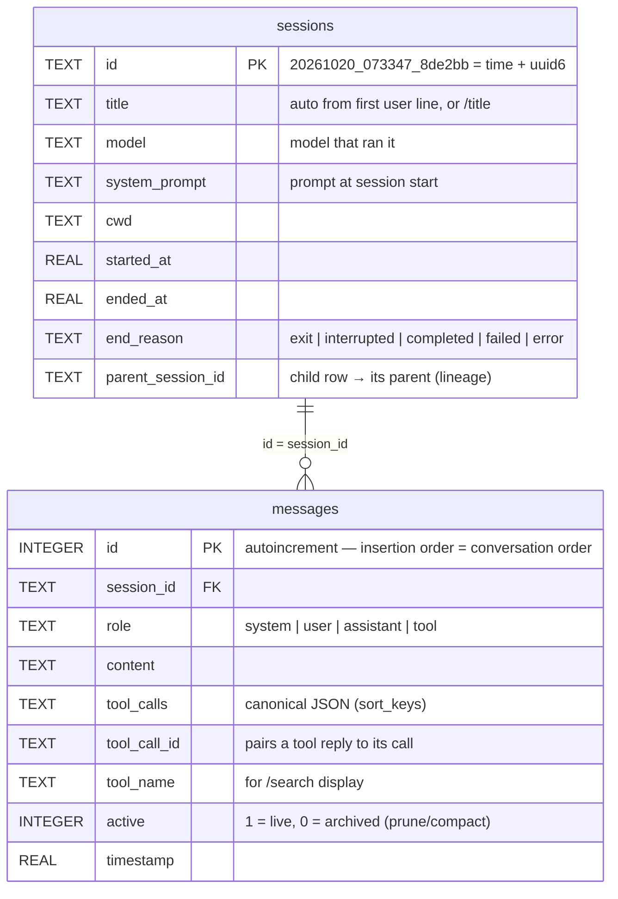
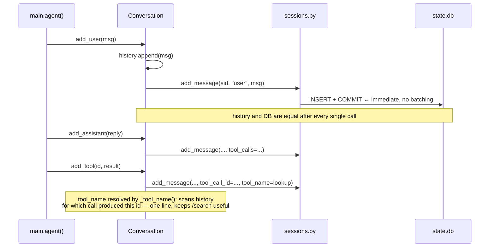
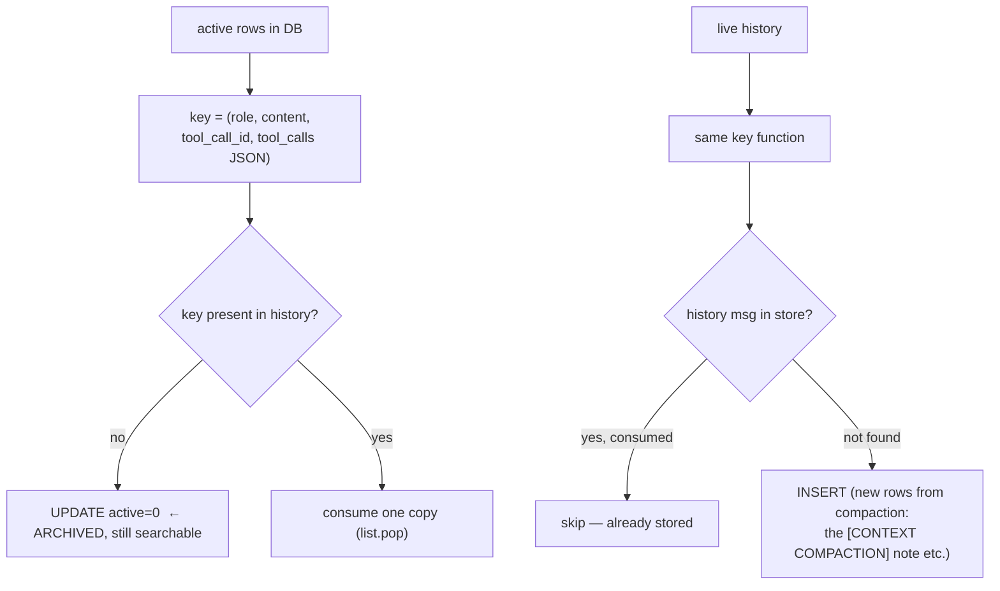
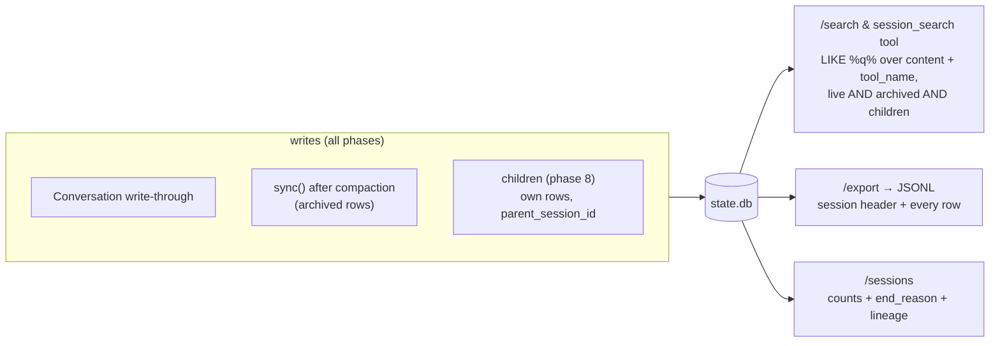

# Phase 6 — Sessions (the SQLite Notebook)

**Problem:** the conversation dies with the process. `Ctrl+C`, a tunnel drop, or
a compacted-away turn means *gone*. And phase 5 promises "nothing is ever
deleted" — with nowhere to archive to, that promise is a lie.

**Deliverable:** `sessions.py` — a SQLite notebook where **every message is
written the moment it happens** (write-through), compaction *archives* rows
(`active=0`) instead of deleting them, sessions resume by id/title, and both you
(`/search`) and the model (`session_search`) can grep everything ever stored —
including subagent transcripts (phase 8).

---

## The store

Single file: `$HARNESS_HOME/state.db` (default `~/.harness/state.db`, outside any
project folder), created lazily on first use.



Two design points hide in those columns:

- **`active` is the archive flag.** Compaction never issues `DELETE`; it flips
  `active=0`. Live queries (`load_messages`) filter `active=1`; `search` and
  `export` do **not** — pruned bytes stay findable. There is no separate
  `context_archive.jsonl`: *the DB is the single archive.*
- **`parent_session_id` is Hermes's lineage.** A child's row points at its
  parent, so `/sessions` and search show the whole family tree of one task.

### Connection strategy (why thread-local)

```python
_local = threading.local()               # one connection PER THREAD

def db():
    conn = getattr(_local, "conn", None)
    if conn is None:
        conn = sqlite3.connect(DB_PATH, timeout=30)
        conn.execute("PRAGMA journal_mode=WAL")   # readers never block writers
        ...
```

Phase 8 runs children in `ThreadPoolExecutor` threads; `sqlite3` connections
are **not** shareable across threads. Each thread opening its own connection on
first use (WAL mode + `timeout=30` for writer contention) makes the notebook
safe for parallel children with zero locking code. `WAL` specifically: a child
committing a row never blocks the parent reading message history.

## Write-through — memory that survives crashes



- `Conversation` methods each append to `history` **and** insert a row. One
  crash point, one durability point — no "did we remember to save?" state.
- Per-message `COMMIT`: a `Ctrl+C` mid-turn leaves every completed message on
  disk; phase 7's interrupted-turn notice keys off a dangling last `user` row.
- The **source of truth is still `history`**; the DB is the mirror. That
  distinction is what `sync()` enforces (below).

## `sync()` — how archive-not-delete actually works

Called only when compaction rewrote history (`convo.sync()` in `main.py` and the
child loop). It makes the store's *active* rows match the live list:



Why **content signature, not row id**: `history` is a list of plain dicts with
no uids — compaction *rebuilds* the list (head + note + tail). Matching on
`(role, content, tool_call_id, tool_calls_json)` makes rewritten rows
identifiable: old middle rows have no live twin → archived; the fresh
compaction note has no stored twin → inserted. Duplicate keys are handled by
consuming from a per-key list (two identical stubs pop twice).

`tool_calls` is canonicalized with `json.dumps(..., sort_keys=True)` on both
sides — key order in dicts can differ between storage and memory; sorted JSON
makes them comparable.

## Sessions lifecycle

```mermaid
stateDiagram-v2
    [*] --> live: /new or startup (new_session)
    live --> ended: exit / end_session(reason="exit")
    ended --> live: /resume (reopen_session + load_messages)
    live --> pruned: /prune (only if ended > 30 days,<br/>never the live one)
    note right of live: children: end_reason = completed / failed<br/>+ parent_session_id set
```

- **ids** are `YYYYMMDD_HHMMSS_<uuid6>` — sortable, prefix-matchable, unique.
- **`find_session(key)`** tries, in order: exact id → `id LIKE 'key%'` →
  `title LIKE '%key%'` newest-first. So `/resume 20261020_07` and
  `/resume refactor` both work. (Bug fixed during the phase: the original loop
  structure returned early after the first query type even on no match —
  rewritten to try all three.)
- **`auto_title`** sets the title from the first user line *only if empty*
  (`WHERE title IS NULL OR title=''`) — `/title` and user intent always win.
- **`load_messages`** rebuilds `history` from `active=1` rows `ORDER BY id` —
  ordering by autoincrement id *is* conversation order.
- **`prune_sessions(days=30, keep=current)`** deletes only *finished* sessions —
  the live session and anything running are untouchable.

## Search & export — the payoff



- `sessions.search()` does not filter `active` — **that's the point**: pruned
  tool output, summarized-away turns, and every child transcript are reachable.
- `session_search` (the *model-facing* tool, thin wrapper) returns
  `[session_id role] text[:300]` lines — enough for the model to decide whether
  to ask `/export` for full bytes.
- `/export` dumps session header + **all** rows (including archived) as JSONL —
  the human-facing escape hatch.

## REPL commands added this phase

| Command | Behavior |
|---|---|
| `/new [title]` | fresh session, prints new id |
| `/sessions` | last 20: id, title, message count, `end_reason` (or `live`) |
| `/resume <id\|title>` | load active rows, set current, show recap of last 20, **interrupted-turn warning** if last row is a dangling user message |
| `/title <t>` | set title |
| `/export` | JSONL path printed |
| `/prune` | delete finished sessions > 30 days (never the live one) |
| `/search <q>` | grep all messages across sessions |

`show_recap()` prints `you:` / `agent:` lines + `[tools: read_file, ...]` so a
resumed session gives immediate bearings without re-prompting.

## Design choices

| Choice | Rejected alternative | Reason |
|---|---|---|
| SQLite over JSONL files | one file per session + append logs | one query answers search/lineage/counts; WAL gives concurrency for phase 8 threads |
| write-through per message | save on exit | exits are where data dies; `Ctrl+C` must be safe |
| `active=0` archive flag | real DELETE | phase 5's promise + phase 6's search both need the bytes |
| match by content signature | trust insertion order | compaction rebuilds history — order and count both change |
| thread-local connections | one shared connection + lock | sqlite3 forbids cross-thread use; per-thread conn needs no lock |
| `sessions.current_id()` global | pass parent id through every call | children read it at spawn time — one line, no plumbing |
| LIKE search | FTS index | tens of thousands of rows; LIKE is plenty and zero schema risk |
| archive inside DB, no JSONL | `context_archive.jsonl` (early draft) | **one** store to back up, query, and reason about |

## Verification (checkpoint)

- kill the REPL mid-conversation → `/resume` restores every completed message
- compact a long session → `/search` finds content from the *archived* rows
- `/sessions` shows message counts + `exit`/`completed` end reasons
- children written with `parent_session_id` visible (phase 8 verification) —
  lineage query: parent → child rows → child summaries
- concurrent child writes + parent reads under WAL: no `database is locked`
  errors during parallel batches
