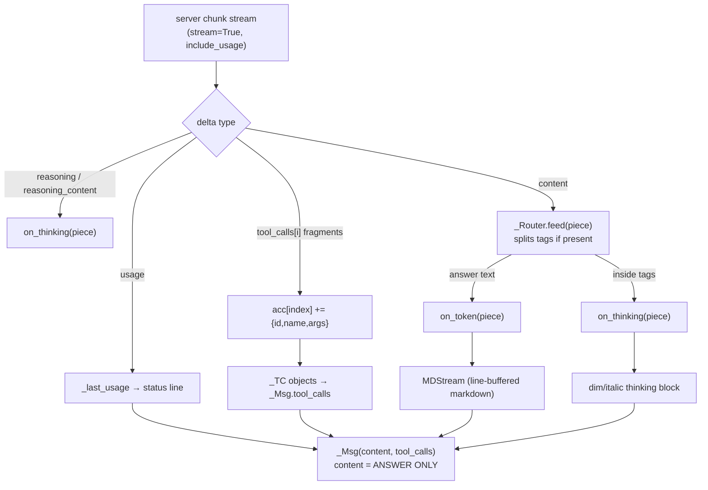
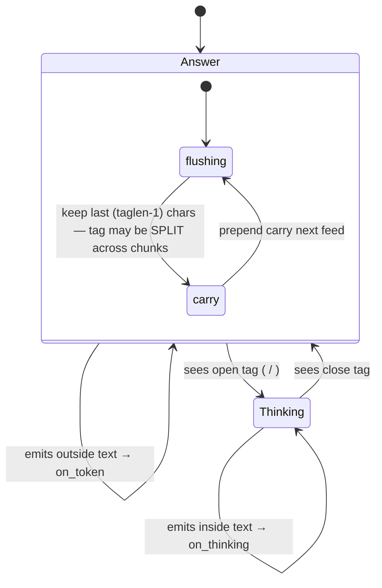
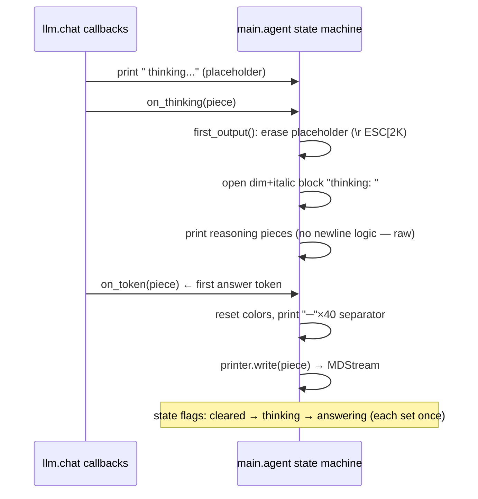

# Phase 7 — Streaming UI + Thinking Tokens

**Problem:** raw token dumps are unreadable, and this model *thinks before it
answers* — the reasoning either clogs the output or gets silently thrown away.

**Deliverable:** `llm.py` streams are split into **thinking** vs **answer**
channels, and `main.py` renders OpenCode-style: a dim/italic thinking block, a
line-buffered markdown renderer with boxed code fences, the tool tree, the
status line, and the banner. Reasoning is *displayed but never stored*.

---

## The streaming pipeline



### `llm.py` — three delta channels

```python
kwargs = {"model": ..., "messages": ..., "max_tokens": 4096,   # reasoning headroom
          "stream": True, "stream_options": {"include_usage": True}}

reasoning = (getattr(delta, "reasoning_content", None)
             or getattr(delta, "reasoning", None))
if reasoning and on_thinking:
    on_thinking(reasoning)          # ← display only; NEVER enters content
if delta.content:
    router.feed(delta.content)
if delta.tool_calls:
    ... accumulate by index, += name and arguments ...
```

- **`max_tokens=4096`** exists purely for reasoning headroom — thinking tokens
  consume the output budget; without the raise, long thoughts hit the cap and
  the answer never arrived.
- Tool-call fragments are reassembled per `index` (phase 1 design), then built
  into `_TC` objects — parallel tool calls (phase 8) arrive as multiple indices
  in one turn, this loop already handled them.

### `_Router` — belt and braces for tagged thinking

Some servers don't use `delta.reasoning`; they embed `<thinking>…</thinking>` or
`<think>…</think>` in plain content. `_Router` is a small state machine fed every content
piece:



The `carry` buffer is the subtle part: a tag arriving as `<thin` + `king>` must
not be printed as content. `feed()` holds back `max(taglen)-1` trailing chars
whenever no tag is found, and `finish()` flushes the remainder at end of stream.

**The invariant that matters:** `_Msg.content` = answer only. Reasoning never
lands in `content`, never gets `convo.add_assistant`'d, never occupies one
token of history. (Same as Hermes: thinking is ephemeral; the transcript holds
answers.)

### The `reasoning_effort` finding (recorded experimentally)

- Sending `reasoning_effort=<anything except omitted/none>` → server error
  *"does not support thinking"*.
- **Omitting the parameter entirely** → server streams real thinking in
  `delta.reasoning`. ✔ verified live.
- Therefore `llm.py` carries **no reasoning parameter at all** — omission is the
  switch. Two field spellings (`reasoning`, `reasoning_content`) are both read,
  because Ollama-family servers use either.

## The renderer (`main.py`)

### `MDStream` — line-buffered markdown

Tokens arrive in arbitrary fragments; rendering must wait for complete lines:

```python
def write(self, chunk):
    self.buf += chunk
    while "\n" in self.buf:
        line, self.buf = self.buf.split("\n", 1)
        styled, self.st = _render_line(line, self.st)
        print(styled, flush=True)
```

`_render_line` is a pure function of `(line, renderer state)`:

| Input | Output |
|---|---|
| three-backtick fence + lang (escaped as a code span) | `┌─ lang` / closing `└─` (state flips `in_code`) |
| line inside code | `│ cyan line` — box-drawn, never re-styled |
| `# ` / `## ` | magenta-bold / bold |
| `- ` / `* ` | green `•` bullet + inline markdown |
| `> ` | dim quote |
| `---` | horizontal rule of `─` × 40 |
| inline | `` `code` `` cyan, `**bold**` bold, `*italic*` italic |

**Why line-buffered, not token-styled:** styling per token breaks across
fragments (`**bo` + `ld**` would bold half). Waiting for `\n` keeps every
transform whole-line; the only state that crosses lines is the code-fence
toggle. `flush()` renders the final unterminated line and auto-closes a
still-open fence (the model sometimes truncates mid-block).

### Thinking → answer handoff in the loop



Three flags in a dict (`cleared/thinking/answering`) make the transitions
idempotent regardless of chunk order; `first_output()` runs on **either**
channel so an empty-thinking answer still erases the placeholder. A
thinking-only reply (no answer tokens) gets a final color reset after `chat()`
returns, so the terminal isn't left dim/italic.

### Tool tree + status line

```
assistant
  ├─ delegate({"tasks":...})          ← every call printed BEFORE running
  └─ [1/2] 1 subagent(s) finished     ← previews as each finishes (phase 8)
  ├─ run_command({...})
  └─ total 104 drwxr-xr-x ...         ← 120-char one-line preview
```

- `├─` lines print for **all** calls first — you see the plan instantly; `└─`
  previews print per completion (parallel-aware, `[i/n]` tagging from phase 8).
- **Status line** after every final answer:
  `model │ ctx 12345/38000 (32%) │ in:9000 out:400` — ctx % comes from the
  phase-5 heuristic (what triggers compaction), `in/out` from real
  `usage` (what the server billed).
- **Banner** on startup: model, cwd, window size, and the prune/compact
  thresholds — the phase-5 config made visible in one glance.
- Hidden `thinking...` indicator + `--clear`-style erase sequences rather than a
  spinner: no threads, no timer, works over any terminal.

## Design choices

| Choice | Rejected alternative | Reason |
|---|---|---|
| reasoning → callback, never history | store thinking in the transcript | pure context cost; answers are what future turns need |
| omit `reasoning_effort` entirely | send `none` / `low` | server rejects every non-omitted value (tested) |
| line-buffered rendering | style per token | fragments split markdown syntax across writes |
| state machine via flags dict | regex the whole stream | callbacks fire in any order; flags are order-proof |
| own ANSI codes, no `rich`/`colorama` | library rendering | zero-dependency ethos; renderer is ~60 lines |
| `max_tokens=4096` fixed | configurable per call | reasoning headroom; one less knob to misconfigure |
| `_Router` kept even with `delta.reasoning` | trust one channel | server variants disagree; both channels coexist safely |

## Known behavior (documented, not a bug)

**Thinking appears on some turns and not others.** The render is purely
event-driven: the block appears only if the server sends reasoning deltas.
Observed patterns with this Ollama-family server:

- trivial prompts ("name one fruit") sometimes stream *no* reasoning at all —
  the model answers directly;
- long/tool-heavy turns consistently think;
- reasoning may also be empty *string* deltas — no visible block, no error.

Nothing in the harness suppresses the display — if the server thinks, you see
it. A repeated-identical-prompt probe (6× same short prompt, count reasoning
arrivals) was started to characterize it precisely; results pending.

## Verification (checkpoint)

- Real-model runs show the full pipeline: hidden placeholder → dim italic
  `thinking:` block → `──` separator → boxed markdown answer → tool tree →
  status line with real `in/out` usage
- Thinking-only replies leave terminal colors reset (no dim bleed)
- A `find .` result through `run_command` rendered boxed + truncated, status
  line `ctx` percentage unchanged (cap held)
- Tool calls with no visible content still print the tree; final answer
  returns through the `else` branch with status line
