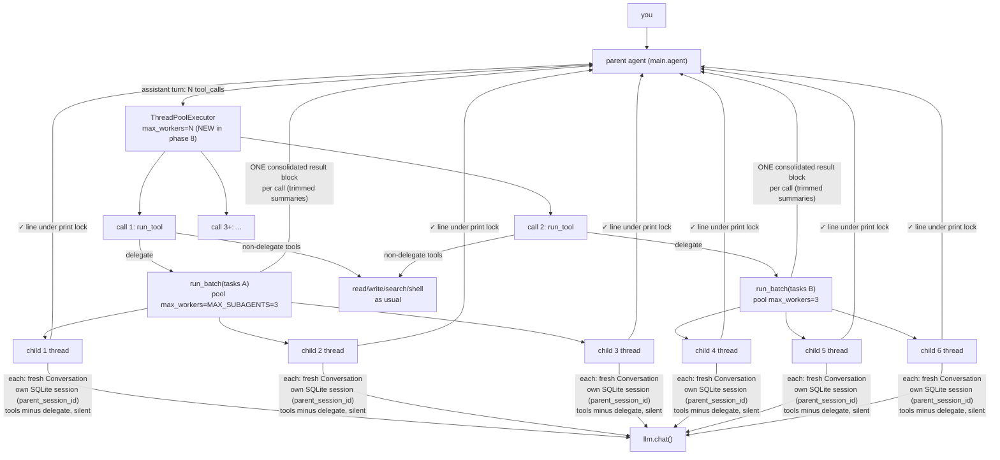
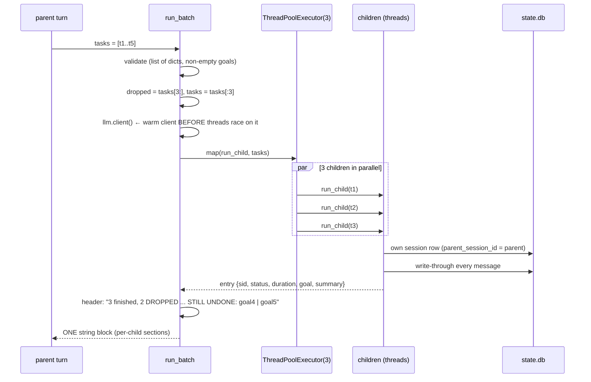
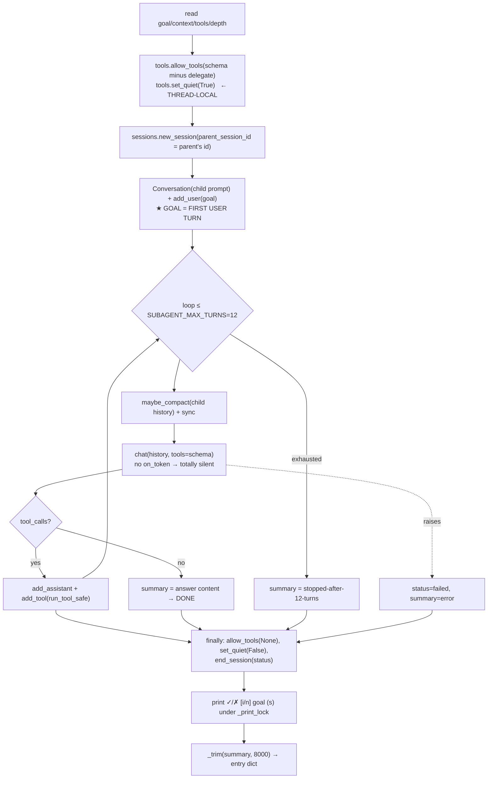

# Phase 8 — Subagents + Parallel Tool Calls

**Problem:** one model turn does one thing at a time. Research + implement +
review could run *side by side* — if independent work could be split into
children that each get their own context window, their own tool loop, and
return only a summary.

**Deliverable:** `subagents.py` (Hermes `delegate_task` port) + the `delegate`
tool in `tools.py` + **two-level parallelism**: tasks inside a batch run
concurrently, *and* several `delegate` calls issued in one assistant turn run
concurrently. Supporting this forced two "invisible" upgrades: **thread-local
flags** in `tools.py` and an **order-preserving parallel executor** in
`main.py`.

---

## The whole picture



**Two independent concurrency layers** — this is the core of the phase:

| Layer | Executor | Cap | Where |
|---|---|---|---|
| tool calls within one turn | `main.py` `ThreadPoolExecutor(max_workers=N)` | one worker per call, unbounded N | `agent()` loop |
| tasks within one `delegate` call | `subagents.py` pool | `MAX_SUBAGENTS = 3` | `run_batch()` |

So `2 delegate calls × 2 tasks` = 4 children on the wire *at once*, plus any
other tools in that turn racing alongside. Verified live (timing evidence in
“Verification” below).

## `delegate` — the tool contract

```python
def delegate(tasks=None) -> str:            # tools.py
    import subagents                        # lazy: children import tools;
    return subagents.run_batch(tasks)       # importing subagents at module top = cycle
```

Schema highlights (why the description is long):

- `tasks[]`, each `{goal (required), context}` — **self-contained goals**: a
  child sees nothing from the parent conversation (Hermes contract).
- Description teaches *both* parallelism modes: *"All tasks of one call run AT
  THE SAME TIME; if you issue SEVERAL delegate calls in one turn, those batches
  also run at the same time. Prefer ONE call with a tasks list when the
  subtasks are siblings."* — models don't reliably discover batching on their
  own; the schema is the lesson.
- `MAX_SUBAGENTS = 3` (Hermes uses 10): one model server behind a tunnel — 6+
  simultaneous streams already stresses it; the knob is `.env`-tunable.

### `run_batch(tasks)` — fan-out + one result back



Key decisions:

- **Validation first**: non-list / empty / goal-less tasks return an *error
  string* (phase-2 idiom) instead of crashing — the parent sees what it did
  wrong and fixes the call.
- **Loud drop notice naming the undone goals**:
  `[3 subagent(s) finished, 2 DROPPED (parallel limit 3) — these are STILL
  UNDONE, delegate them in a follow-up call: go-3 | go-4]`
  An early version said only `1 dropped (limit 3)` — the model then had to
  *infer* which task fell through by reading summaries. Naming the goals lets
  it re-delegate exactly the missing work (observed: it did, next turn,
  unaided).
- **`llm.client()` warmed before the pool starts**: first-use client creation
  from 3 threads at once was a race; warming in the parent removes it.
- **One consolidated result per call** (Hermes): N children's chatter is folded
  into a single tool message with per-child sections — the parent pays *one*
  result's protocol cost and reads a clean report:

```
[2 subagent(s) finished]
── subagent ─────────────────────────
goal:    list config.py settings
status:  completed (8.5s)
session: 20261020_073401_ab12cd   (full transcript — session_search knows it)
summary:
...trimmed text...
```

## `run_child(task, index, n)` — one child's life



### The child prompt (`_child_prompt`)

```
<default_system_prompt>

CONTEXT:
<whatever the parent put in task.context — file paths, errors, constraints>

Complete this task using your tools. When finished, answer with a TIGHT summary:
what you did, what you found, files changed, issues. Bullets over paragraphs. ...

NOTE: you are at the maximum nesting depth; you cannot delegate further.
```

- **The goal is NOT in the system prompt** — it's the first `add_user()` turn,
  so the child's history opens exactly the way a human session does (Hermes
  contract; also makes child transcripts readable in `/resume`).
- *"TIGHT summary"* instruction **at spawn time**: the parent only ever receives
  this text, so teaching brevity up front beats trimming garbage later.
- Depth line depends on `MAX_SPAWN_DEPTH = 1`: current default is **flat** —
  children are told they *can't* delegate; at depth < max they'd instead get
  *"you are an orchestrator, you have 'delegate'"*. The knob exists; nesting is
  just off by default (Hermes default, and one model server shouldn't fork
  recursively).

### Tool restriction = thread-local, not global

```python
_allowed = threading.local()      # tools.py
def allow_tools(names=None):      # restriction for THIS thread only
    _allowed.names = None if names is None else set(names)
```

`run_tool` checks `getattr(_allowed, "names", None)` — pool threads start
unrestricted, the child thread restricts *itself*, `finally` resets it. Why not
a module global: with parallel batches, batch A's finishing child would clear
batch B's restriction — one batch silently escaping its toolset. Same story for
`_quiet`:

> **Bug this replaced:** the original design used `tools.QUIET = True/False`
> (process-global). With two `delegate` calls racing, child A's `finally:
> QUIET = False` un-muted batch B *while its children were still streaming* —
> interleaved garbage in the parent's UI. Fix: `set_quiet()` on
> `threading.local()` — each child silences itself; the parent's thread is
> never muted.

Also thread-local: `sessions.db()` connections (phase 6) — children in pool
threads each open their own SQLite connection (WAL + timeout 30), no locking
code anywhere.

### Summary trim — protect the parent's window

```python
def _trim(summary, sid, cap):        # cap = 8000 chars
    if len(summary) <= cap: return summary
    head, tail = int(cap*0.75), int(cap*0.25)      # Hermes numbers: 75/25
    return summary[:head] + "\n[... middle omitted ...]\n" + summary[-tail:] \
         + f"\n[full transcript in session {sid} — recover with session_search]"
```

| | Hermes | here |
|---|---|---|
| ceiling | 24 000 chars, scaled by available headroom | fixed 8 000 (`.env`-tunable) — windows are 50k, children are chatty |
| cut | head 75 % + tail 25 % | same |
| what the middle becomes | spilled to a file on disk | **session id pointer** — phase 6's notebook *is* the spill file; `/export` or `session_search` recovers bytes |

Because a child's full transcript is written through to its own session row,
trimming loses nothing — the summary is a *view*, the DB is the record.

### `run_tool_safe` — a child can't die from one call

Children use `run_tool_safe(call)` (try/except → `"Error: {e}"`), one layer
outside `run_tool` itself: `run_tool` can throw on *unknown tool names*
(`REGISTRY[name]` KeyError) — the child schema is built statically from
`SCHEMA`, but a defensive wrapper keeps one oddity from turning a `completed`
child into `failed`.

## Parallel tool calls in `main.py` — the other executor

Before this phase, `agent()` ran `for tool in reply.tool_calls:` **serially** —
two `delegate` calls would have run one *after* the other. Now:

```python
convo.add_assistant(reply)
calls = reply.tool_calls
for tool in calls:                          # 1. show ALL calls first
    print(f"  ├─ {tool.function.name}({args[:100]})")
results = {}
if len(calls) == 1:                         # 2a. single call: no pool overhead
    results[0] = run_tool(calls[0])
    print(f"  └─ {preview}")
else:                                       # 2b. N calls: run CONCURRENTLY
    with ThreadPoolExecutor(max_workers=len(calls)) as pool:
        futures = {pool.submit(run_tool, t): i for i, t in enumerate(calls)}
        for fut in as_completed(futures):   # print previews AS they finish
            i = futures[fut]
            results[i] = fut.result()
            print(f"  └─ [{i+1}/{len(calls)}] {preview}")
for i, tool in enumerate(calls):            # 3. store in ORIGINAL CALL ORDER
    convo.add_tool(tool.id, results[i])
```

Three subtle points, each hard-won:

1. **Display order ≠ storage order.** `as_completed` gives you results in
   *finish* order (nice UX: tick-tock), but the API contract requires tool
   messages matching `tool_calls[i]` in sequence — so previews print
   opportunistically while `add_tool` iterates `enumerate(calls)`. Protocol
   invariant (README rule 7) preserved.
2. **`add_assistant` before the pool** — if a child hangs or the process dies
   mid-batch, the transcript already records *what was asked*; phase 6's
   interrupted-turn logic still works.
3. **`max_workers=len(calls)`** — the model chose these N calls *because* they
   were parallelizable; under-provisioning would silently serialize.

What does **not** change: non-delegate tools racing in the same pool is safe
(read-only tools are pure; `write_file`/`edit_file` to the *same* path in one
turn is a model error the unique-match check largely catches).

## Design choices

| Choice | Rejected alternative | Reason |
|---|---|---|
| children = fresh `Conversation` in a thread | fork the parent history | Hermes contract + parent's context stays ~2–8 % |
| goal as first user turn | goal in system prompt | transcripts read naturally; prompt-builder stays dumb |
| `delegate` excluded from child schema | allow recursion with depth check in code | schema-level removal is *free* and can't be bypassed |
| MAX_SUBAGENTS=3 | Hermes's 10 | one tunnel-served model; `.env` raises it when the server can take it |
| flat depth (1) default | recursive orchestrators | each nesting level multiplies context cost exponentially; knob is there |
| thread-local quiet/allow | global flags | parallel batches would corrupt each other (the bug above) |
| per-batch executor + per-turn executor | one global scheduler | two simple pools compose into N×M concurrency without a scheduler |
| drop notice names goals | silent truncate | model re-delegates exactly the undone work (observed working) |
| trim to pointer + session id | Hermes spill files | phase 6 notebook already stores it — no second storage system |
| summary cap 8000 | 24000/Hermes-dynamic | 50k window; 3 children × 8k must leave room for the answer |
| `pool.map` per batch | one flat pool for all tasks | batches are the model's own grouping; keeping them separate makes the drop boundary per-call |
| consolidate N results into 1 tool message | one result per child | one protocol slot per call — same as Hermes' single-result contract |

## Scale & load notes

- Worst realistic case: N turn-calls × 3 children = 6+ simultaneous streams
  against the tunnel; expect slower per-child times and possible 429/timeouts.
  If requests start failing: lower `MAX_SUBAGENTS` (graceful — fewer parallel
  children, same code path) or issue batches in separate turns.
- Children are **silent**: no thinking blocks, no tool prints, no markdown —
  only the parent's UI renders; ✓/✗ lines print under `_print_lock` so two
  finishing children never interleave half-lines.

## Verification (checkpoint)

1. **Mocked mechanics** (no server): two batches × 0.3 s child sleep →
   total 0.34 s (serial would be ≥0.6 s), tool result ids returned as
   `[d1, d2]` — order preserved.
2. **Dropped-goals header**: 5 mock tasks → `[3 finished, 2 DROPPED …: go-3 | go-4]`.
3. **Real model, one call, 4 tasks**: 3 children ran concurrently (✓ lines at
   8.5 s / 17.4 s overlapping), 1 dropped, model **re-delegated the dropped task
   on its own** in the next turn.
4. **Real model, two calls in one turn** (the phase's headline):

```
  ├─ delegate({...batch A, 2 tasks...})
  ├─ delegate({...batch B, 2 tasks...})     ← same assistant turn
  ✓ [2/2] 70.8s   ┐ A and B children
  ✓ [1/2] 84.5s   ┘ interleaved
  └─ [1/2] batch A result printed — batch B STILL RUNNING   ← proof of concurrency
  ✓ [2/2] 113.9s
  ✓ [1/2] 130.2s
  └─ [2/2] batch B result
```

   Final answer synthesized all four reports; parent context at **8 %**.
5. **DB lineage**: child rows present with `parent_session_id` set,
   `end_reason=completed`; `/sessions` and `session_search` reach child
   transcripts from the parent's search.

## What's next (candidates discussed)

- Hermes **steer / stop / list** control actions on running children
  (`action="steer"` injects text into a child's next tool result; `stop` ends
  early with a partial result)
- orchestrator depth 2 (`MAX_SPAWN_DEPTH=2` switch — code already branches)
- logging safety decisions into the notebook (phase 4 gates calls and shows
  approvals in the UI; children already inherit the static policy through
  `run_tool`)
