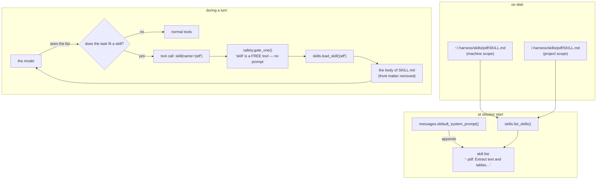
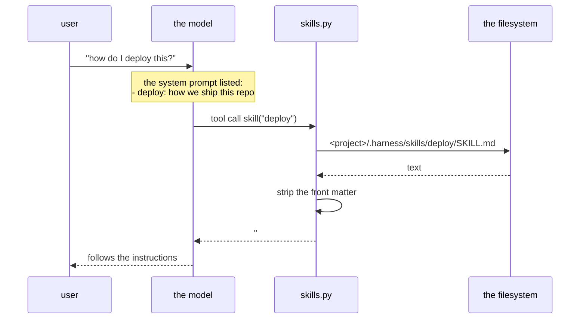

# Phase 9 — Skills (loadable instructions, the Claude Code way)

**Problem:** the system prompt is one string. Everything the agent should know
about *this* project — how to release it, how its PDFs are laid out, which
house rules the team has — has to be either (a) hard-coded in the harness, or
(b) pasted into every single message by hand. Both are wrong: the first is
not portable, the second is not repeatable, and neither can grow.

**Deliverable:** `skills.py` — a folder of instructions the agent loads **on
demand**, the way Claude Code does it. The model is told which skills *exist*
(name + description, a few dozen tokens each) and pulls the full text only
when the task actually fits one. Two scopes (this machine / this project), a
`skill` tool, a `/skills` command, and the skill list folded into the system
prompt.

---

## The whole picture



**Progressive disclosure** is the whole idea: the *catalogue* is always in
context, the *content* only when needed. A skill costs ~30 tokens while it
sits idle and its full text (up to 20 000 chars) for exactly one turn.

## The `SKILL.md` format

A skill is a **directory** with a `SKILL.md` inside. The file starts with a
small front matter block, then the instructions:

```markdown
---
name: pdf
description: Extract text and tables from PDF files
---

# Working with PDFs

Use `pdftotext -layout` for the text…
Never edit a PDF with a text editor — use `qpdf` first.
```

The front matter is parsed by 12 lines of code (`skills._parse`):

```python
def _parse(text: str) -> tuple[dict, str]:
    text = text.lstrip("")
    if not text.startswith("---"):
        return {}, text
    parts = text.split("---", 2)          # opening ---, front matter, body
    if len(parts) < 3:
        return {}, text
    meta: dict[str, str] = {}
    for line in parts[1].strip().splitlines():
        if ":" not in line:
            continue
        key, _, value = line.partition(":")
        meta[key.strip().lower()] = value.strip().strip("'\"")
    return meta, parts[2].lstrip("\n")
```

| Field | Required | Meaning |
|---|---|---|
| `name` | no | the name the model uses. Falls back to the **folder name** |
| `description` | no | one line: *when* should this skill be loaded? Falls back to the **first line of the body** |

No YAML library: the front matter is a flat `key: value` block, and anything
the harness does not know (`allowed-tools:`, `version:`, …) is parsed and
ignored rather than rejected. A skill that is *not* valid front matter still
works — it is just a body with no description, and the description falls back
to its first heading.

## Two scopes, and which one wins

```python
def global_dir()  -> Path: return config.HARNESS_HOME / "skills"   # ~/.harness/skills
def project_dir() -> Path: return config.START_DIR / ".harness" / "skills"
```

| Scope | Folder | Who sees it | Typical content |
|---|---|---|---|
| **machine** | `~/.harness/skills/<name>/SKILL.md` | every project on this machine | your own house rules, a preferred workflow |
| **project** | `<project>/.harness/skills/<name>/SKILL.md` | only that project | how *this* repo is built, tested, released |

Both are read at **call time** (`global_dir()` / `project_dir()` are
functions, not constants) — so the project scope follows the runtime project
switch (`harness <folder>`, `harness-tui <folder>`, `--project`), and a
folder that is renamed mid-session is picked up on the next lookup.

**Precedence: the project wins.** `list_skills()` fills a dict keyed by
name, and the scopes are walked machine-first, project-second — the project's
entry overwrites the machine's. `load_skill()` walks them in the opposite
order (project first) so it finds the same one. A project can therefore
*override* a machine skill with the same name — the common case: the team
ships `deploy`, you also have a personal `deploy`; the team's wins inside the
repo, yours wins everywhere else.



## The `skill` tool

```python
def skill(name: str) -> str:            # tools.py
    import skills                        # lazy: keeps the import graph flat
    return skills.load_skill(name)
```

Schema:

```python
_tool("skill",
      "Load the full instructions of a skill. The available skills are "
      "listed in your system prompt; load one when the task fits it.",
      {"name": _str("the skill name, e.g. 'pdf'")}, ["name"]),
```

- **Free tier** (`safety.FREE_TOOLS`): reading a local file is a read, so it
  never asks for approval and is allowed in `plan` mode.
- **A miss is an ordinary error string** (rule 3), and it lists what *is*
  available, so the model can correct itself in the next turn:

  ```
  error: no skill named 'pdfx'. available skills: deploy, pdf, release
  ```

- **The body is capped** at `MAX_SKILL_CHARS = 20_000` — a skill is
  instructions, not a data dump. Over the cap the text is cut and marked
  `...[truncated]`.

## The catalogue in the system prompt

```python
def default_system_prompt() -> str:
    base = ("You are a coding agent. You have tools, use them as needed. "
            "Inspect before acting. If a tool errors, adjust and retry. Be concise.")
    try:
        import skills
        extra = skills.prompt_line()
    except Exception:
        extra = ""
    return f"{base}\n\n{extra}" if extra else base
```

`prompt_line()` returns the empty string when there are no skills, so the
prompt is byte-identical to the old one on a machine with no skills (no
regression for anyone who never uses them):

```
You are a coding agent. You have tools, use them as needed. Inspect before acting. If a tool errors, adjust and retry. Be concise.

You can load a skill when the task fits it (the skill tool gives you its full instructions):
- pdf: Extract text and tables from PDF files
- deploy: How this repo is released
```

**Why the list, and not the whole file:** the model needs to *decide* whether
a skill applies. That decision needs the description, not the instructions —
the instructions are what it gets *after* deciding.

**Why the description is the important part:** it is the only text the model
sees before loading. Claude Code puts the same pressure on it; a skill whose
description is *"a skill"* will never be picked, a skill described as *"use
when the user asks about PDFs, invoices or scanned documents"* will.

The prompt line is built at **session start** (`default_system_prompt()` is
called by `new_session()`), so a skill added mid-session is visible in the
*next* session. That is deliberate: the system prompt is written once, into
the notebook, and the transcript of a session should not change under the
model's feet.

## The surfaces

| Where | What |
|---|---|
| `/skills` (CLI) | lists `name  [scope]  description` for every skill |
| `/skills` (TUI) | same list, as a note in the chat |
| the `skill` tool | the model loading a skill by itself |
| `~/.harness/skills/` | machine scope |
| `<project>/.harness/skills/` | project scope — and this one **is** committable |

The `.gitignore` keeps the v1 `.harness/` state out of git but lets the
skills through:

```
.harness/*         # v1: state lived in the project; it now lives in $HARNESS_HOME
!.harness/skills/  # ...but project skills are yours to commit
```

A project skill is therefore a reviewable artifact: it shows up in the diff,
it is versioned with the code it describes, and it travels with a clone of
the repo. That is the difference between a skill and a paragraph in a chat.

## Design choices

| Choice | Rejected alternative | Reason |
|---|---|---|
| catalogue in the system prompt, body on demand | put every skill in the prompt | a skill is instructions *for one task*; all of them at once is noise that costs tokens on every turn |
| one folder per skill (`<name>/SKILL.md`) | one flat file with all skills | a skill can grow files of its own (templates, references) and the name is the folder, not a heading |
| `name:` from the front matter, else the folder name | require `name:` | a folder named `pdf` should be the skill `pdf`; the front matter is for the *description* |
| description falls back to the first line of the body | description is mandatory | a half-written skill should still work |
| project scope beats machine scope | machine scope beats project scope | the repo's own instructions are more specific than the machine's |
| skill bodies are **not** stored in the notebook | copy the text into the session | the skill file is the source of truth; the transcript only says "loaded skill pdf" |
| `skill` is a **free** tool | ask before loading | it is a local read; prompting on every skill would train the user to hit `a` without reading |
| cap 20 000 chars | no cap | one runaway skill must not eat the window (rule 4) |
| flat `key: value` front matter, no YAML lib | PyYAML | a new dependency for two fields; unknown keys are ignored, not an error |
| the list is built at session start | rebuilt on every turn | the system prompt is written once into the notebook; a prompt that changes under the model is worse than one that is a turn late |

## Security notes

A skill is **local content the user put on disk** — the same trust level as
the project's own `AGENT.md` (phase 9's sibling, read the same way). It is
*not* like a web page: `web_fetch` output can carry prompt injection, a
`SKILL.md` cannot arrive on its own.

The one thing to keep in mind: **loading a skill steers the model**. A skill
that says *"run this script"* is code the model will run, so a skill from
somebody else deserves the same review as a shell script from somebody else.
This is why project skills are committable and reviewable, and why the
machine scope is a place for *your own* rules.

The safety gate still applies to whatever the skill makes the model do: a
skill cannot talk the agent past `safety.gate_one()` — the skill is text, the
tools it triggers are still gated.

## Scale & load notes

- **Cost when idle:** 0. The catalogue line is empty when there are no skills;
  with N skills it is N × ~20 tokens, once per session.
- **Cost when used:** the body of one skill, once, in that turn's context.
- **Lookup cost:** two directory listings per call (`list_skills()` /
  `load_skill()`), a few stat() calls each — microseconds. No caching was
  needed; the file system is the cache.
- **A skill that is 20 000 characters** eats 4 % of a 50 000-token window on
  its own. The cap keeps the worst case bounded; the *description* is what
  decides whether that ever happens.

## Verification (checkpoint)

1. **Discovery** — a project skill and a machine skill are both found, with
   the right scope and the right description (front matter).
2. **Precedence** — a project skill with the same name as a machine one wins
   (both in the list and on load).
3. **The prompt** — `default_system_prompt()` contains the catalogue, and is
   **byte-identical to the old prompt** when there are no skills.
4. **The tool** — `skill("deploy")` returns the body with the front matter
   removed; `skill("nope")` returns an error string that lists what *is*
   available.
5. **The gate** — `skill` is in `FREE_TOOLS`: no approval prompt, allowed in
   `plan` mode, refused by nothing.
6. **The CLI** — `/skills` lists the skills; the system prompt of a new
   session contains the catalogue.
7. **The TUI** — `/skills` lists them as a note in the chat; a `skill` tool
   call shows up as a normal tool block.
8. **Offline** — all of the above are pure file-system checks; they need no
   model server (`test/test_model_skills.py`, 47 checks in that file).

> **Not verified live:** the model *choosing* to load a skill on its own
> needs a working model endpoint. The endpoint this machine was using
> (a trycloudflare tunnel) stopped resolving mid-phase, so the "the model
> reads the catalogue and calls `skill`" step is verified by construction
> (the tool is in the schema, the catalogue is in the prompt) and not yet by
> observation. That check is the first thing to run when the tunnel is back.

## What else landed in this phase

Not documented here (they get their own phase docs):

- the **Textual TUI** (`tui/`) — an opencode-style front-end over the same
  core, driven through `tui/adapter.py`; the harness core is untouched apart
  from the `stop` hook on `llm.chat()`
- the **web tools** — `web_search` (DuckDuckGo via `ddgs`) and `web_fetch`
  (a page as text, GitHub blob URLs rewritten to raw, local/private addresses
  refused)
- the **machine-wide model** — `/model` sets the model for the machine
  (`$HARNESS_HOME/settings.json`), and the TUI's `/model` window can add a
  model from another endpoint (base url + api key → read its model list →
  pick one)

## What's next (candidates)

- a skill that carries **files** (templates, checklists) next to `SKILL.md`,
  loaded as an extra tool result
- **per-project skill sets** in a manifest (`.harness/skills.toml`) so a
  repo can pin which skills it expects
- skills for the **subagents** — a child could load a skill of its own
  (today the catalogue is only in the parent's system prompt)
